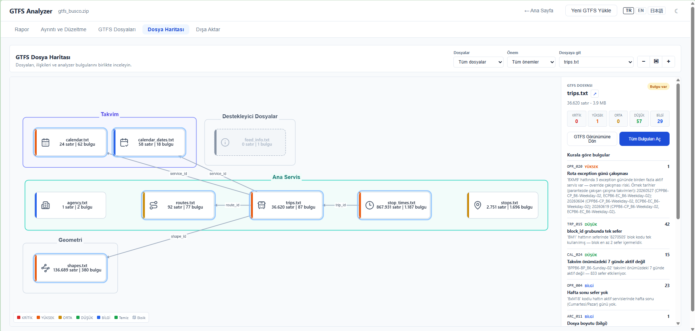

# GTFS Validator & Analyzer

🇹🇷 [Türkçe](README.md) · 🇬🇧 **English** · 🇯🇵 [日本語](README.ja.md) · 🇫🇷 [Français](README.fr.md)

[](https://ttezer.github.io/gtfs-analyzer/)
[](https://www.gtfs.jp/)
[](RULES.en.md)

[](https://crates.io/crates/gtfs-analyzer)
[](https://www.npmjs.com/package/gtfs-sdk)
[](https://chatgpt.com/plugins/plugin_asdk_app_6ac28e6e2354819182f3b14bce32014c)
[](https://claude.ai/customize/plugins/id/13a4a596-abf5-4301-91bc-41425febc400%40anthropic-plugin-directory?via=directory)
[](LICENSE)

**GTFS Validator & Analyzer** is an open-source **GTFS validator** that checks GTFS files and analyzes feed quality. A `.zip` uploaded to the web app is never sent to a server; validation runs on the user's device with **WebAssembly**. The same **630-rule** engine is reachable in eight ways:

| Path | Best for |
|---|---|
| **Browser** ([app](https://ttezer.github.io/gtfs-analyzer/)) | Inspecting one feed with the map and report |
| **CLI** (`cargo install gtfs-analyzer`, or a prebuilt binary) | Batch validation, scripting, and Python integration |
| **Rust library** ([`gtfs-pipeline`](https://crates.io/crates/gtfs-pipeline)) | Embedding validation in your own Rust service |
| **CI/CD** (exit codes + `--fail-on`) | A release gate before publishing a feed |
| **[`gtfs-sdk`](https://www.npmjs.com/package/gtfs-sdk) npm package** | Embedding validation in your web or Node application |
| **[`gtfs-analyzer`](https://pypi.org/project/gtfs-analyzer/) Python package** (`pip install gtfs-analyzer`) | Embedding validation in your Python application |
| **ChatGPT — [GTFS Validator](https://chatgpt.com/plugins/plugin_asdk_app_6ac28e6e2354819182f3b14bce32014c)** | Validating a ZIP or URL in a conversation and explaining the findings |
| **Claude — [GTFS Validator](https://claude.ai/customize/plugins/id/13a4a596-abf5-4301-91bc-41425febc400%40anthropic-plugin-directory?via=directory)** | Validating a ZIP, path or URL with `/gtfs` and explaining the findings |

## Key Features

- **630 validation and analysis rules** in 39 groups; **97.2%** of the measurable provisions of the GTFS specification are covered, and **all 300 atoms** of the field inventory carry at least one Spec anchor. Full list: [`RULES.en.md`](RULES.en.md).
- **Runs locally:** the browser, the CLI, the libraries and the npm/Python packages process the feed on your own device.
- **Quality and operations beyond Spec compliance:** anomalous speed segments, frequency inconsistencies, isolated stops, service gaps, network topology.
- **Four classes, five severity levels:** every finding is tagged Spec · Interop · Quality · Analytics and Critical → Info, so thousands of findings can be filtered and prioritized.
- **Two scores:** the **Publish Score** for publishability and the weighted **Overall Score** of the four classes.
- **Prioritized fix queue:** what to tackle first and how much a fix may move the score.
- **File, row and remediation step for every finding.**
- **For Planners page:** turns the technical report into a plain-language task list for planners who do not know GTFS (below).
- **Map:** stop, shape, trip, route and pathway issues are drawn on the real shape geometry.
- **GTFS Flex and Fares v2** validation; the GTFS features a feed uses (Shapes, Transfers, Fares, Headsigns, Flex…) are detected automatically.
- **GTFS-JP profile:** Japan's national profile is recognized automatically, with v3 and v4 checked separately.
- **Outputs:** HTML, CSV, JSON, compact JSON and the Executive PDF Report; run-to-run comparison.
- **CI/CD gate:** `--fail-on` and exit codes stop a pipeline only at the class/severity you choose.
- **Four interface languages:** Turkish, English, Japanese, French.

**Who is it for?**

- **Transit operators and municipalities** — To validate a feed and resolve quality issues before publishing.
- **GTFS integrators and consultants** — To document the technical and operational quality of delivered data.
- **Application developers** — To assess the reliability and integration risks of the feeds they consume.
- **Researchers and analysts** — To compare different transit networks in terms of data quality and structure.

---

## For Planners

The **For Planners** page of the web app tells the same analysis result in the planner's language instead of a technical report; it produces no new findings, it simplifies the Analyzer's result.

- **A one-line verdict:** can the feed be published, and how many topics block publication.
- **Two lists:** first the issues that block publication, then the improvement suggestions that do not — in priority order.
- **A card for every topic:** what it is, what to do and **where to fix it**, with the route code, stop name and departure time a planner knows instead of file and column names.
- **On the map:** the affected stops, routes and trips are drawn on the real route geometry.
- **Cards in five languages:** Turkish, English, Japanese, French and Spanish.

---

## Our Corpus Results

Every release is run against **MobilityDatabase's entire GTFS Schedule catalogue**. Latest run (`44623468896`, 2026-11-19):

| | |
|---|---:|
| Feeds attempted | **4,481** |
| Valid ZIPs downloaded | **4,449** |
| Analysis completed | **4,449** (no failures) |
| Partial report (broken/missing file skipped safely) | 76 |
| Countries | 95 |
| Rules triggered | 423 / 621 (previous measurement) |
| Median time per feed | **0.05 s** (p90 1.1 s) |
| Median peak memory per feed | **15 MB** (p90 149 MB) |
| Total time | 86.7 min |

**Speed.** The whole catalogue, 25.8 GB of compressed GTFS, was validated in **86.7 minutes** on a 4-core CI machine:

| Validation time | Feeds | Share |
|---|---:|---:|
| Under 0.1 seconds | 2,761 | **62.1%** |
| Under 1 second | 3,968 | **89.2%** |
| Under 10 seconds | 4,370 | **98.2%** |
| Under 1 minute | 4,437 | **99.7%** |

**Memory.** Peak memory per feed: **mean 100 MB, median 15 MB**.

| Peak memory | Feeds | Share |
|---|---:|---:|
| Under 100 MB | 3,866 | **86.9%** |
| Under 500 MB | 4,281 | **96.2%** |
| Under 1 GB | 4,367 | **98.2%** |
| Under 4 GB | 4,438 | **99.8%** |

The largest feeds finish in minutes too:

| Feed | ZIP | Extracted | Time | Peak memory |
|---|---:|---:|---:|---:|
| Sweden-wide (Trafiklab, `mdb-2939`) | 908 MB | 4.5 GB | 2 min 48 s | 9.3 GB |
| Baden-Württemberg (NVBW, `mdb-2393`) | 700 MB | 4.6 GB | 1 min 26 s | 7.0 GB |
| Germany-wide (DELFI, `mdb-3215`) | 589 MB | 4.9 GB | 6 min 1 s | 12.9 GB |
| Entur (`mdb-1078`) | 554 MB | 3.4 GB | 1 min 1 s | 5.0 GB |
| Great Britain-wide (BODS, `mdb-2014`) | 1.93 GB | 11.7 GB | 6 min 36 s | 13.2 GB |
| Czechia (`mdb-2904`) | 86 MB | 0.85 GB | 58 s | 5.5 GB |

The tables inside these feeds are huge as well; every row is read and checked:

| Feed | `stop_times` | Trips | Shape points | Calendar exceptions | Transfers | Time |
|---|---:|---:|---:|---:|---:|---:|
| Germany-wide (DELFI, `mdb-3215`) | **65.1 million** | 3.17 million | 10.5 million | 456 k | 1.07 million | 6 min 1 s |
| Switzerland-wide (SKI+, `mdb-2898`) | **42.6 million** | 2.62 million | — | **10.5 million** | 1.12 million | 1 min 51 s |
| Baden-Württemberg (NVBW, `mdb-2393`) | 6.5 million | 373 k | **57.5 million** | 340 k | 106 k | 1 min 26 s |
| Buenos Aires (Colectivos, `mdb-1220`) | **29.3 million** | 436 k | 756 k | 95 | — | 53 s |
| Bogotá (SIMUR, `mdb-3358`) | 9.6 million | 182 k | 942 k | 126 | — | 22 s |
| Great Britain-wide (BODS, `mdb-2014`) | **69.5 million** | 1.76 million | **89.7 million** | 278 k | — | 6 min 36 s |
| Czechia (`mdb-2904`) | 9.6 million | 494 k | — | **4.4 million** | — | 58 s |

A prior 621-rule build validated Buenos Aires' 29.3 million `stop_times` rows in 53 seconds: about **548,000 rows per second**.

The Great Britain-wide BODS feed, the Germany-wide DELFI feed and two regional Nouvelle-Aquitaine feeds (77 and 83 MB) are among the feeds MobilityData's `gtfs-validator` stopped with an internal error in this run; GTFS Analyzer validated all four to the end.

**Size.** There is no fixed feed size limit. The only ceiling is a 16 GB safety guard on extracted data against zip bombs; in the browser, browsers with Memory64 use the WASM64 engine and the device's memory sets the limit.

The largest feed in the catalogue, **Great Britain-wide BODS** (`mdb-2014`): 11.7 GB of data and 69.5 million `stop_times` rows are validated end to end in **6.5 minutes** on a 16 GB CI machine; it also opens **in the browser** (Memory64, ~8.5 minutes, ~13.6 GB of WASM memory).

The **Czechia** feed (`mdb-2904`) is a genuinely broken feed with 494,000 trips and 1.07 million findings: it is validated in **under a minute** and also opens **in the browser**.

Partial reports are not failures: in feeds whose files sit in a subfolder instead of the ZIP root (48), that lack a required file (22) or whose geometry file exceeds the safety limit (6), independent checks continue and the skipped checks are listed in the report. Raw results: [`audit-results/`](audit-results/).

---

## GTFS-JP Support

GTFS Analyzer recognizes Japan's national GTFS profile **GTFS-JP** (国土交通省 / MLIT standard) automatically and applies the rules that GTFS-JP makes mandatory where standard GTFS leaves them optional. Because MLIT requires subsidized operators to publish GTFS-JP, hundreds of small operators must conform to this profile.

- **Automatic detection:** GTFS-JP extension files (`agency_jp.txt`, `office_jp.txt`, `pattern_jp.txt`, the legacy `routes_jp.txt`), `feed_lang=ja`, kana (`ja-Hrkt`) translations, `agency_lang=ja` + `Asia/Tokyo`, or Japanese kana in name fields mark a feed as GTFS-JP; the report shows a **GTFS-JP** badge.
- **Profile selection:** in the web app **Analysis Criteria → GTFS-JP profile scope** (`Auto`, `V3`, `V4`); in the CLI `--gtfs-jp-profile v3|v4`; in the SDK `config: { gtfs_jp_profile: 'v3' }`. The choice does not detect the feed's official version; it only sets the rule scope.
- **100% machine-checkable coverage:** with an explicit V3 or V4 profile, every machine-checkable MLIT provision is covered by rules; provisions that need human judgement or are recommendations only are out of scope.
- **Rules:** the profile rules are in the **JPN** group and run only on GTFS-JP feeds; full list in [`RULES.en.md`](RULES.en.md).

### Profile monitors and difference pages

| Page | What it shows |
|---|---|
| [GTFS-JP Monitor](https://ttezer.github.io/gtfs-jp-monitor/) | GTFS-JP profile results of Japanese feeds |
| [GTFS-FR Monitor](https://ttezer.github.io/gtfs-fr-monitor/) | Results of French feeds |
| [GTFS-JP v3/v4 compatibility matrix](docs/gtfs-jp-v3-v4-matrix.md) | Rule differences between v3 and v4 |

---

## ChatGPT and Claude: Ask in Any Language, Get Answers in That Language

GTFS Validator runs as a plugin in ChatGPT and in Claude. Give it your feed in the chat and get the result **in the language you ask in**: ask in English and it answers in English, ask in Japanese and it answers in Japanese. The GTFS Analyzer engine computes the validation and the scores; the AI explains the result, summarizes the priority fixes clearly and does not change the scores.

### ChatGPT — GTFS Validator

Open ChatGPT's [GTFS Validator page](https://chatgpt.com/plugins/plugin_asdk_app_6ac28e6e2354819182f3b14bce32014c) and add the app. Type `/gtfs` and upload a GTFS ZIP, give a public feed URL, or ask what a rule such as `/gtfs TRP_002` means.

### Claude — GTFS Validator

Add the [GTFS Validator plugin](https://claude.ai/customize/plugins/id/13a4a596-abf5-4301-91bc-41425febc400%40anthropic-plugin-directory?via=directory) in Claude. Type `/gtfs` and attach a GTFS ZIP, give a file path or a public feed URL, or ask about a rule such as `/gtfs TRP_002`. The plugin uses code execution; on claude.ai it must be enabled, and there attach the feed as a ZIP rather than a URL.

**Example questions:** "Is this feed ready to publish?", "Explain the three most important issues and how to fix them", "What does STP_046 mean?"

---

## Eight Ways to Use It

| Path | How to start | Details |
|---|---|---|
| Browser | [Open the app](https://ttezer.github.io/gtfs-analyzer/) and drop the ZIP | [Browser](docs/usage.en.md#1-browser) |
| CLI | `cargo install gtfs-analyzer` or a [prebuilt binary](https://github.com/ttezer/gtfs-analyzer/releases) | [CLI](docs/usage.en.md#2-cli) |
| Rust library | `gtfs-pipeline` dependency | [Rust](docs/usage.en.md#3-rust-library) |
| CI/CD | `--fail-on` and exit codes | [CI/CD](docs/usage.en.md#4-cicd) |
| npm | `npm install gtfs-sdk` | [npm](docs/usage.en.md#5-gtfs-sdk-npm-package) |
| Python | `pip install gtfs-analyzer` | [Python](docs/usage.en.md#6-python-package) |
| ChatGPT | [GTFS Validator](https://chatgpt.com/plugins/plugin_asdk_app_6ac28e6e2354819182f3b14bce32014c), `/gtfs` | above |
| Claude | [GTFS Validator](https://claude.ai/customize/plugins/id/13a4a596-abf5-4301-91bc-41425febc400%40anthropic-plugin-directory?via=directory), `/gtfs` | above |

All installation and usage details: [Eight ways to use it](docs/usage.en.md).

---

## Analysis Criteria, Scores and Notice Limits

The authority source of the rule classes, the adjustable thresholds, how the **Publish Score** and the **Overall Score** are computed, and notice limits on large feeds: [analysis document](docs/analysis.en.md).

---

## Report Tabs

### 1. Report
Summary overview: both scores, feed metrics (route count, trip count, date range, etc.), and a notice distribution chart.

### 2. For Planners
The same result in the planner's language: the publish verdict, first the issues that block publication, then the improvement suggestions; for each topic what it is, what to do and where to fix it, with the map. Details in the **For Planners** section above.

### 3. Detail & Fix
Issues are presented as a prioritized fix queue, sorted by priority score. Each row contains:

| Column | Description |
|---|---|
| **Score** | Priority score — computed as `Severity × (1 + Dependent) × log₂(1 + Count) / Effort`; higher = fix first |
| **+Pub** | Publish Score gain if this rule is fixed |
| **+Score** | Overall Score gain if this rule is fixed |
| **Dependent** | How many other active rules close automatically if this one is fixed |
| **Effort** | Fix effort: 1 = single field change, 2 = limited cross-file, 3 = structural / data model revision |

The sum of all +Pub values equals `100 − current Publish Score`; the sum of all +Score values equals `100 − current Overall Score`. Geographic issues show a map icon; clicking it displays the problem location and related shape/stop data on an interactive map. Clicking the **rule code** opens the relevant GTFS specification section in a new tab — the reference page of the file the finding most affects (gtfs.jp for GTFS-JP rules).

### 4. By Category
All rule violations listed by group and class. Each row shows the rule code, title, affected record count, severity, and remediation guidance. Filtering and sorting are supported.

### 5. Export
Download the report as HTML, CSV, or JSON. The PDF option opens the browser's print dialog — use "Save as PDF" to export.

---

## Interactive GTFS File Map

GTFS Validator & Analyzer includes an interactive File Map that combines the GTFS data structure with the real validation findings of the analyzed feed.

This view is not a static schema. It shows the files present in the feed, the missing ones, the findings, and the validated file relationships based on the analysis result.

### Features

- Shows the seven core GTFS files in the **Calendar** and **Core Service** groups
- Shows non-core standard files only when the analyzer reports a finding for them
- Lists non-spec files found in the feed in a separate group
- Visualizes validated GTFS relationships such as `route_id`, `trip_id`, `stop_id`, `service_id`, and `shape_id`
- Colors files by their highest finding severity
- Distinguishes missing, clean, and problematic files
- Shows row count, file size, finding count, and severity distribution
- Lists findings by rule, always ordered **Critical → High → Medium → Low → Info**
- Opens all findings of the selected file in a filtered Detail & Fix view
- Provides file-presence and severity filters
- Supports zoom, fit-to-screen, dark theme, and a mobile layout

When a file is selected, only its validated and related GTFS connections expand. Non-spec files stay visible, but no unvalidated relationships are drawn.

Analysis and visualization run entirely in the browser. GTFS files are never uploaded to any server.



---

## Run-to-Run Comparison

GTFS Validator & Analyzer can compare two analyses of the same feed (before/after) to show what a fix round improved and what it regressed. Open **Compare** and upload the **Golden JSON** you downloaded from an earlier analysis; the diff is computed against the current run.

### Features

- Shows the before/after change in Publish, Overall, and sub-scores (Spec, Interop, Quality, Analytics)
- Classifies each rule as **Fixed, Decreased, Increased, New, or Same**, with filtering and search
- Shows the change in severity (Critical → Info) and class (Spec/Interop/Quality/Analytics) distribution
- Compares feed structure (trip, stop, `stop_times` and `calendar_dates` row counts) and feed/service date ranges
- Normalizes notice density **per 1,000 trips** and **per 100,000 stop_times**, so feeds of different sizes are comparable
- Warns when the two runs differ in feed name, date range, or configuration, so a misleading delta is not misread
- Exports the comparison as CSV
- Also reads legacy Golden schemas (v1–v3)

The comparison runs entirely in the browser. The Golden JSON is parsed locally; nothing is uploaded to any server.

---

## Rule Classes

| Class | What it measures | Affects |
|---|---|---|
| **Spec** | Deviations from the GTFS specification — missing required fields, invalid values, referential integrity errors | Publish (Critical only) and Overall |
| **Interop** | Spec-compliant but rejected or misinterpreted by common consumers (Google Maps, Apple Maps, etc.) | Overall (Interop score) |
| **Quality** | Missing optional but expected fields, inconsistencies, deviations from best practices | Overall Score |
| **Analytics** | Service pattern analysis — bunching, sparse service, expired service | Overall Score |

---

## Severity Levels

| Level | Meaning |
|---|---|
| **Critical** | Makes the feed unusable or causes data loss |
| **High** | Significant functional issue; strongly recommended to fix |
| **Medium** | Inconsistency that warrants attention |
| **Low** | Minor deviation from best practice |
| **Info** | Informational; action may not be required |

Severity combines the file/field requirement level (Required · Conditionally Required · Recommended · Optional) from the [GTFS Schedule Reference](https://gtfs.org/documentation/schedule/reference/#file-requirements) with the finding's semantic impact.

### Spec severity rubric

Spec severity combines requirement level and semantic impact, that is, the effect of the violation on whether the GTFS data can be consumed:

- **Critical:** Required file/field, primary-key or foreign-key integrity, or core type/range violation; the feed cannot be consumed reliably and `Spec + Critical` is the publish gate.
- **High:** A direct normative violation that materially changes schedule, fare, accessibility, or Flex/pathway semantics even though the feed remains parseable.
- **Medium:** A localized or conditional normative violation while the main data model remains readable.
- **Low:** A narrow metadata or optional-field normative deviation; it does not block publication.
- **Info:** Not used for normative Spec violations; reserved for measurement or context signals.

Therefore no `Spec` rule has `Info` severity.

For GTFS-JP feeds, the **JPN** group rules are based on the official [GTFS-JP specification](https://www.gtfs.jp/) (gtfs.jp).

---

---

## Rule Groups

Each rule is coded as `GROUP_NNN`. Groups follow GTFS file and component boundaries.

| Group | GTFS Component | Description |
|---|---|---|
| **ARC** | Archive / file level | ZIP extraction, file format, required file presence, character encoding |
| **AGN** | `agency.txt` | Agency information and multi-agency consistency |
| **CAL** | `calendar.txt` | Service calendars and weekly day patterns |
| **CLD** | `calendar_dates.txt` | Service exception dates and date validity |
| **STP** | `stops.txt` | Stop locations, hierarchy, and accessibility information |
| **RTS** | `routes.txt` | Route definitions, route type, color, and naming |
| **TRP** | `trips.txt` | Trip definitions, block and shape associations |
| **STM** | `stop_times.txt` | Stop timings, speed, sequence, and timing consistency |
| **SHP** | `shapes.txt` | Route shapes, point order, and stop alignment |
| **FRQ** | `frequencies.txt` | Frequency-based trips and headway values |
| **TRF** | `transfers.txt` | Transfer definitions, types, and duration validity |
| **FAR** | `fare_attributes.txt` | Fare definitions, currency, and payment method |
| **FRL** | `fare_rules.txt` | Route- and zone-based fare rules |
| **FIN** | `feed_info.txt` | Feed publisher information, language, validity dates |
| **LIC** | `licenses.txt` | Feed-wide and table-specific license declarations |
| **PTH** | `pathways.txt` | In-station pathway network and accessibility connections |
| **LVL** | `levels.txt` | Station floors and elevator/stairway relationships |
| **TRN** | `translations.txt` | Field translations and language consistency |
| **ATR** | `attributions.txt` | Data source and attribution information |
| **XFL** | Cross-file | Cross-file referential integrity and consistency |
| **GEO** | Geographic analysis | Coordinate consistency, outlier detection, clustering |
| **OPR** | Operational analysis | Inter-trip wait times, route density, stop repetition |
| **VAT** | Network topology | Isolated stops, disconnected routes, network accessibility |
| **DQ** | Feed-wide quality | General data quality metrics and threshold checks |
| **RCT** | `rider_categories.txt` | Rider categories, age ranges, and default category (Fares v2) |
| **FMD** | `fare_media.txt` | Payment media: physical card, mobile app, EMV, etc. (Fares v2) |
| **FPD** | `fare_products.txt` | Fare products, amount, currency, and media/category associations (Fares v2) |
| **FLG** | `fare_leg_rules.txt` | Per-leg fare rules and priority (Fares v2) |
| **FLJ** | `fare_leg_join_rules.txt` | Rules that join two legs across a transfer into one effective fare leg (Fares v2) |
| **FTR** | `fare_transfer_rules.txt` | Transfer fare rules and time limits (Fares v2) |
| **ARS** | `areas.txt` | Geographic area definitions (Fares v2) |
| **SAR** | `stop_areas.txt` | Stop–area mappings (Fares v2) |
| **NET** | `networks.txt` | Network definitions (Fares v2) |
| **TFR** | `timeframes.txt` | Time frame groups and service calendar associations (Fares v2) |
| **BKR** | `booking_rules.txt` | Demand-responsive booking rules, advance notice windows, and booking types (GTFS Flex) |
| **PDW** | Flex window rules | Demand-responsive pickup/drop-off time window consistency in `stop_times.txt` (GTFS Flex) |
| **LOC** | `locations.geojson` | Geometry and format validation of flexible service zones (GTFS Flex) |
| **GGL** | Google Transit specific | Rules additionally required or restricted by Google Maps and Google Transit |
| **JPN** | GTFS-JP profile | Japan national GTFS-JP profile rules — kana readings, `office_jp.txt`/`agency_jp.txt` referential integrity (GTFS-JP feeds only) |

---

## Developer Setup

### Requirements

- **Rust** — GNU toolchain (`stable-x86_64-pc-windows-gnu`), MinGW gcc
- **wasm-pack** — WASM build tool
- **Node.js** — a maintained LTS release (exact range in `ui/package.json` > `engines`)

> **Windows note:** The GNU toolchain is required instead of MSVC. During the WASM build, `wasm-opt` is downloaded and this step is incompatible with the MSVC linker. MinGW `gcc` must be on the PATH.

```powershell
# Rust GNU toolchain (once)
rustup toolchain install stable-x86_64-pc-windows-gnu
rustup override set stable-x86_64-pc-windows-gnu
```

### Build

```powershell
# 1. Install dependencies
cd ui
npm install

# 2. Compile WASM
npm run wasm

# 3. Compile UI
npm run build
# Output: ui/dist/
```

### Dev Server

```powershell
cd ui
npm install
npm run dev
```

### Tests

```powershell
# Rust unit and integration tests
cargo test

# Blocking lint for every workspace crate, test, and example target
cargo clippy --workspace --all-targets --all-features -- -D warnings

# Playwright smoke tests
cd ui
npx playwright test
```

## Project Structure

```
gtfs-validator/
├── crates/
│   ├── config/     # Configuration types
│   ├── core/       # Shared data structures and result model
│   ├── pipeline/   # Validation pipeline (k1–k7 stages)
│   ├── rules/      # Rule definitions and registry (630 rules, 39 groups)
│   └── wasm/       # wasm-bindgen WASM output
├── spec-audit/     # Field table generated from the spec (anchor gate)
└── ui/             # Vite + TypeScript frontend
    ├── pkg/          # wasm-pack output (generated, committed)
    ├── src/
    │   └── pages/    # Application tabs (domain/fix/rules/export)
    └── tests/        # Playwright tests
```

## Acknowledgements

**Akira Nishizawa** (西澤明), Executive Director of the Japan Bus Information Association: our
sincere thanks for supporting our GTFS-JP work and for the valuable time he gave us.

## License

MIT — see [LICENSE](LICENSE) for details.
