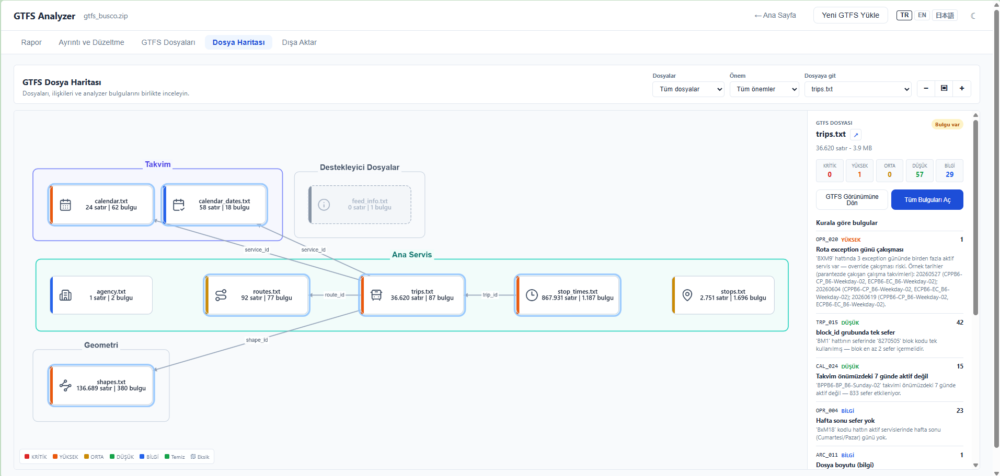

# GTFS Validator & Analyzer

🇹🇷 [Türkçe](README.md) · 🇬🇧 [English](README.en.md) · 🇯🇵 [日本語](README.ja.md) · 🇫🇷 **Français**

[](https://ttezer.github.io/gtfs-analyzer/)
[](https://www.gtfs.jp/)
[](RULES.fr.md)

[](https://crates.io/crates/gtfs-analyzer)
[](https://www.npmjs.com/package/gtfs-sdk)
[](https://chatgpt.com/plugins/plugin_asdk_app_6ac28e6e2354819182f3b14bce32014c)
[](https://claude.ai/customize/plugins/id/13a4a596-abf5-4301-91bc-41425febc400%40anthropic-plugin-directory?via=directory)
[](LICENSE)

**GTFS Validator & Analyzer** est un **validateur GTFS** open source qui contrôle les fichiers GTFS et analyse la qualité des jeux de données. Un `.zip` téléversé dans l’application web n’est jamais envoyé à un serveur ; la validation s’exécute sur l’appareil de l’utilisateur avec **WebAssembly**. Le même moteur de **630 règles** est accessible de neuf façons :

| Voie | Idéal pour |
|---|---|
| **Navigateur** ([application](https://ttezer.github.io/gtfs-analyzer/)) | Examiner un jeu de données avec la carte et le rapport |
| **CLI** (`cargo install gtfs-analyzer`, ou un binaire précompilé) | Validation par lots, scripts et intégration Python |
| **Bibliothèque Rust** ([`gtfs-pipeline`](https://crates.io/crates/gtfs-pipeline)) | Intégrer la validation dans votre propre service Rust |
| **CI/CD** (codes de sortie + `--fail-on`) | Une barrière de publication avant de diffuser un jeu de données |
| **Paquet npm [`gtfs-sdk`](https://www.npmjs.com/package/gtfs-sdk)** | Intégrer la validation dans votre application web ou Node |
| **Paquet Python [`gtfs-analyzer`](https://pypi.org/project/gtfs-analyzer/)** (`pip install gtfs-analyzer`) | Intégrer la validation dans votre application Python |
| **Paquet R `gtfsanalyzer`** (GitHub, `subdir = "r"`) | Valider des jeux et comparer des versions d’horaires depuis R |
| **ChatGPT — [GTFS Validator](https://chatgpt.com/plugins/plugin_asdk_app_6ac28e6e2354819182f3b14bce32014c)** | Valider un ZIP ou une URL dans une conversation et expliquer les signalements |
| **Claude — [GTFS Validator](https://claude.ai/customize/plugins/id/13a4a596-abf5-4301-91bc-41425febc400%40anthropic-plugin-directory?via=directory)** | Valider un ZIP, un chemin ou une URL avec `/gtfs` et expliquer les signalements |

## Fonctionnalités clés

- **630 règles de validation et d’analyse**, en 39 groupes ; **97,2 %** des exigences mesurables de la spécification GTFS sont couvertes et **les 300 atomes** de l’inventaire des champs portent au moins un ancrage Spec. Liste complète : [`RULES.fr.md`](RULES.fr.md).
- **Exécution locale :** le navigateur, la CLI, les bibliothèques et les paquets npm/Python traitent le jeu de données sur votre propre appareil.
- **Qualité et exploitation au-delà de la conformité Spec :** segments de vitesse anormaux, incohérences de fréquence, arrêts isolés, interruptions de service, topologie du réseau.
- **Quatre classes, cinq niveaux de gravité :** chaque constat est étiqueté Spec · Interop · Quality · Analytics et Critique → Info ; des milliers de constats se filtrent et se priorisent.
- **Deux scores :** le **score de publication** et le **score global** pondéré des quatre classes.
- **File de correction priorisée :** ce qu’il faut traiter d’abord et l’effet probable de la correction sur le score.
- **Fichier, ligne et étape de correction pour chaque constat.**
- **Page Pour les planificateurs :** transforme le rapport technique en une liste de tâches en langage clair pour les planificateurs qui ne connaissent pas GTFS (ci-dessous).
- **Carte :** les problèmes d’arrêts, de tracés, de courses, de lignes et de cheminements sont dessinés sur la géométrie réelle du tracé.
- **Validation GTFS Flex et Fares v2** ; les fonctionnalités GTFS utilisées par le jeu (Shapes, Transfers, Fares, Headsigns, Flex…) sont détectées automatiquement.
- **Profil GTFS-JP :** le profil national japonais est reconnu automatiquement, v3 et v4 contrôlés séparément.
- **Sorties :** HTML, CSV, JSON, JSON compact et rapport de direction PDF ; comparaison entre deux analyses.
- **Barrière CI/CD :** `--fail-on` et les codes de sortie n’arrêtent le pipeline qu’à la classe/gravité choisie.
- **Quatre langues d’interface :** turc, anglais, japonais, français.

**À qui s’adresse-t-il ?**

- **Exploitants de transport et collectivités** — pour valider un jeu de données et résoudre les problèmes de qualité avant publication.
- **Intégrateurs et consultants GTFS** — pour documenter la qualité technique et opérationnelle des données livrées.
- **Développeurs d’applications** — pour évaluer la fiabilité et les risques d’intégration des jeux de données consommés.
- **Chercheurs et analystes** — pour comparer différents réseaux de transport sous l’angle de la qualité et de la structure des données.

---

## Pour les planificateurs

La page **Pour les planificateurs** de l’application web présente le même résultat d’analyse dans la langue du planificateur plutôt que dans un rapport technique ; elle ne produit aucun nouveau constat, elle simplifie le résultat de l’Analyzer.

- **Un verdict en une phrase :** le jeu de données peut-il être publié, et combien de sujets bloquent la publication.
- **Deux listes :** d’abord les problèmes qui bloquent la publication, puis les suggestions d’amélioration qui ne la bloquent pas — par ordre de priorité.
- **Une fiche par sujet :** ce que c’est, quoi faire et **où corriger**, avec le code de ligne, le nom d’arrêt et l’heure de départ que connaît le planificateur au lieu des noms de fichiers et de colonnes.
- **Sur la carte :** les arrêts, lignes et courses concernés sont dessinés sur la géométrie réelle du parcours.
- **Fiches en cinq langues :** turc, anglais, japonais, français et espagnol.

---

## Nos résultats sur corpus

Chaque version est exécutée sur **l’intégralité du catalogue GTFS Schedule de MobilityDatabase**. Dernière exécution (`44623468896`, 2026-11-19) :

| | |
|---|---:|
| Jeux de données tentés | **4 481** |
| ZIP valides téléchargés | **4 449** |
| Analyse terminée | **4 449** (sans échec) |
| Rapport partiel (fichier cassé/manquant ignoré sans risque) | 76 |
| Pays | 95 |
| Règles déclenchées | 423 / 621 (mesure précédente) |
| Durée médiane par jeu | **0,05 s** (p90 1,1 s) |
| Mémoire maximale médiane par jeu | **15 MB** (p90 149 Mo) |
| Durée totale | 86,7 min |

**Vitesse.** L’ensemble du catalogue, 25,8 Go de GTFS compressé, a été validé en **86,7 minutes** sur une machine CI à 4 cœurs :

| Durée de validation | Jeux de données | Part |
|---|---:|---:|
| Moins de 0,1 seconde | 2 761 | **62,1 %** |
| Moins de 1 seconde | 3 968 | **89,2 %** |
| Moins de 10 secondes | 4 370 | **98,2 %** |
| Moins de 1 minute | 4 437 | **99,7 %** |

**Mémoire.** Mémoire maximale par jeu de données : **moyenne 100 Mo, médiane 15 Mo**.

| Mémoire maximale | Jeux de données | Part |
|---|---:|---:|
| Moins de 100 Mo | 3 866 | **86,9 %** |
| Moins de 500 Mo | 4 281 | **96,2 %** |
| Moins de 1 Go | 4 367 | **98,2 %** |
| Moins de 4 Go | 4 438 | **99,8 %** |

Les plus gros jeux de données se terminent aussi en quelques minutes :

| Jeu de données | ZIP | Décompressé | Durée | Mémoire maximale |
|---|---:|---:|---:|---:|
| Suède entière (Trafiklab, `mdb-2939`) | 908 Mo | 4,5 Go | 2 min 48 s | 9,3 Go |
| Bade-Wurtemberg (NVBW, `mdb-2393`) | 700 Mo | 4,6 Go | 1 min 26 s | 7,0 Go |
| Allemagne entière (DELFI, `mdb-3215`) | 589 Mo | 4,9 Go | 6 min 1 s | 12,9 Go |
| Entur (`mdb-1078`) | 554 Mo | 3,4 Go | 1 min 1 s | 5,0 Go |
| Grande-Bretagne entière (BODS, `mdb-2014`) | 1,93 Go | 11,7 Go | 6 min 36 s | 13,2 Go |
| Tchéquie (`mdb-2904`) | 86 Mo | 0,85 Go | 58 s | 5,5 Go |

Les tables de ces jeux de données sont elles aussi énormes ; chaque ligne est lue et contrôlée :

| Jeu de données | `stop_times` | Courses | Points de tracé | Exceptions de calendrier | Correspondances | Durée |
|---|---:|---:|---:|---:|---:|---:|
| Allemagne entière (DELFI, `mdb-3215`) | **65,1 millions** | 3,17 millions | 10,5 millions | 456 k | 1,07 million | 6 min 1 s |
| Suisse entière (SKI+, `mdb-2898`) | **42,6 millions** | 2,62 millions | — | **10,5 millions** | 1,12 million | 1 min 51 s |
| Bade-Wurtemberg (NVBW, `mdb-2393`) | 6,5 millions | 373 k | **57,5 millions** | 340 k | 106 k | 1 min 26 s |
| Buenos Aires (Colectivos, `mdb-1220`) | **29,3 millions** | 436 k | 756 k | 95 | — | 53 s |
| Bogotá (SIMUR, `mdb-3358`) | 9,6 millions | 182 k | 942 k | 126 | — | 22 s |
| Grande-Bretagne entière (BODS, `mdb-2014`) | **69,5 millions** | 1,76 million | **89,7 millions** | 278 k | — | 6 min 36 s |
| Tchéquie (`mdb-2904`) | 9,6 millions | 494 k | — | **4,4 millions** | — | 58 s |

Une version antérieure à 621 règles a validé les 29,3 millions de lignes `stop_times` de Buenos Aires en 53 secondes : environ **548 000 lignes par seconde**.

Le jeu BODS pour toute la Grande-Bretagne, le jeu DELFI pour toute l’Allemagne et deux jeux régionaux de Nouvelle-Aquitaine (77 et 83 Mo) font partie des jeux que le `gtfs-validator` de MobilityData a interrompus sur une erreur interne lors de cette exécution ; GTFS Analyzer les a validés tous les quatre jusqu’au bout.

**Taille.** Il n’y a pas de limite fixe de taille. Le seul plafond est une protection de 16 Go sur les données décompressées contre les bombes zip ; dans le navigateur, ceux qui prennent en charge Memory64 utilisent le moteur WASM64 et c’est la mémoire de l’appareil qui fixe la limite.

Le plus gros jeu de données du catalogue, **BODS pour toute la Grande-Bretagne** (`mdb-2014`) : 11,7 Go de données et 69,5 millions de lignes `stop_times` sont validés de bout en bout en **6,5 minutes** sur une machine CI de 16 Go ; le jeu s’ouvre aussi **dans le navigateur** (Memory64, ~8,5 minutes, ~13,6 Go de mémoire WASM).

Le jeu de données **tchèque** (`mdb-2904`) est réellement défectueux, avec 494 000 courses et 1,07 million de constats : il est validé en **moins d’une minute** et s’ouvre aussi **dans le navigateur**.

Les rapports partiels ne sont pas des échecs : pour les jeux dont les fichiers sont dans un sous-dossier au lieu de la racine du ZIP (48), auxquels il manque un fichier obligatoire (22) ou dont le fichier de géométrie dépasse la limite de sécurité (6), les contrôles indépendants se poursuivent et les contrôles ignorés sont listés dans le rapport. Résultats bruts : [`audit-results/`](audit-results/).

---

## Prise en charge de GTFS-JP

GTFS Analyzer reconnaît automatiquement **GTFS-JP**, le profil GTFS national du Japon (国土交通省 / norme MLIT), et applique les règles que GTFS-JP rend obligatoires là où GTFS standard les laisse facultatives. Comme le MLIT impose aux exploitants subventionnés de publier en GTFS-JP, des centaines de petits exploitants doivent se conformer à ce profil.

- **Détection automatique :** les fichiers d’extension GTFS-JP (`agency_jp.txt`, `office_jp.txt`, `pattern_jp.txt`, l’ancien `routes_jp.txt`), `feed_lang=ja`, des traductions en kana (`ja-Hrkt`), `agency_lang=ja` + `Asia/Tokyo` ou du kana japonais dans les champs de nom marquent le jeu comme GTFS-JP ; le rapport affiche un badge **GTFS-JP**.
- **Choix du profil :** dans l’application web **Critères d’analyse → portée du profil GTFS-JP** (`Auto`, `V3`, `V4`) ; en CLI `--gtfs-jp-profile v3|v4` ; dans le SDK `config: { gtfs_jp_profile: 'v3' }`. Ce choix ne détecte pas la version officielle du jeu ; il fixe seulement la portée des règles.
- **Couverture à 100 % de ce qui se contrôle automatiquement :** avec un profil V3 ou V4 explicite, toutes les dispositions MLIT contrôlables automatiquement sont couvertes par des règles ; celles qui demandent un jugement humain ou ne sont que des recommandations sont hors champ.
- **Règles :** les règles du profil sont dans le groupe **JPN** et ne s’exécutent que sur les jeux GTFS-JP ; liste complète dans [`RULES.fr.md`](RULES.fr.md).

### Suivi des profils et pages de différences

| Page | Ce qu’elle montre |
|---|---|
| [GTFS-JP Monitor](https://ttezer.github.io/gtfs-jp-monitor/) | Résultats du profil GTFS-JP des jeux japonais |
| [GTFS-FR Monitor](https://ttezer.github.io/gtfs-fr-monitor/) | Résultats des jeux de données français |
| [Matrice de compatibilité GTFS-JP v3/v4](docs/gtfs-jp-v3-v4-matrix.md) | Différences de règles entre v3 et v4 |

---

## ChatGPT et Claude : posez la question dans votre langue, recevez la réponse dans votre langue

GTFS Validator fonctionne comme extension dans ChatGPT et dans Claude. Donnez votre jeu de données dans la conversation et obtenez le résultat **dans la langue de votre question** : en français si vous demandez en français, en japonais si vous demandez en japonais. Le moteur GTFS Analyzer calcule la validation et les scores ; l’IA explique le résultat, résume clairement les corrections prioritaires et ne modifie pas les scores.

### ChatGPT — GTFS Validator

Ouvrez la [page GTFS Validator](https://chatgpt.com/plugins/plugin_asdk_app_6ac28e6e2354819182f3b14bce32014c) de ChatGPT et ajoutez l’application. Tapez `/gtfs` et téléversez un ZIP GTFS, donnez l’URL publique d’un jeu de données, ou demandez ce que signifie une règle comme `/gtfs TRP_002`.

### Claude — GTFS Validator

Ajoutez l’[extension GTFS Validator](https://claude.ai/customize/plugins/id/13a4a596-abf5-4301-91bc-41425febc400%40anthropic-plugin-directory?via=directory) dans Claude. Tapez `/gtfs` et joignez un ZIP GTFS, donnez un chemin de fichier ou l’URL publique d’un jeu de données, ou posez une question sur une règle comme `/gtfs TRP_002`. L’extension utilise l’exécution de code ; sur claude.ai elle doit être activée, et il faut y joindre le jeu de données en ZIP plutôt qu’en URL.

**Exemples de questions :** « Ce jeu de données est-il prêt à être publié ? », « Explique les trois problèmes les plus importants et comment les corriger », « Que signifie STP_046 ? »

---

## Neuf façons de l’utiliser

| Voie | Pour commencer | Détails |
|---|---|---|
| Navigateur | [Ouvrez l’application](https://ttezer.github.io/gtfs-analyzer/) et déposez le ZIP | [Navigateur](docs/usage.fr.md#1-navigateur) |
| CLI | `cargo install gtfs-analyzer` ou un [binaire prêt à l’emploi](https://github.com/ttezer/gtfs-analyzer/releases) | [CLI](docs/usage.fr.md#2-cli) |
| Bibliothèque Rust | dépendance `gtfs-pipeline` | [Rust](docs/usage.fr.md#3-bibliothèque-rust) |
| CI/CD | `--fail-on` et codes de sortie | [CI/CD](docs/usage.fr.md#4-cicd) |
| npm | `npm install gtfs-sdk` | [npm](docs/usage.fr.md#5-paquet-npm-gtfs-sdk) |
| Python | `pip install gtfs-analyzer` | [Python](docs/usage.fr.md#6-paquet-python) |
| R | `remotes::install_github("ttezer/gtfs-analyzer", subdir = "r")` | [R](docs/usage.fr.md#7-paquet-r) |
| ChatGPT | [GTFS Validator](https://chatgpt.com/plugins/plugin_asdk_app_6ac28e6e2354819182f3b14bce32014c), `/gtfs` | ci-dessus |
| Claude | [GTFS Validator](https://claude.ai/customize/plugins/id/13a4a596-abf5-4301-91bc-41425febc400%40anthropic-plugin-directory?via=directory), `/gtfs` | ci-dessus |

Tous les détails d’installation et d’usage : [Neuf façons de l’utiliser](docs/usage.fr.md).

---

## Critères d’analyse, scores et plafonds de signalements

La source d’autorité des classes de règles, les seuils réglables, le calcul du **score de publication** et du **score global**, et les plafonds de signalements sur les gros jeux de données : [document d’analyse](docs/analysis.fr.md).

---

## Onglets du rapport

### 1. Rapport
Vue de synthèse : les deux scores, les métriques du jeu de données (nombre de lignes, nombre de courses, plage de dates, etc.) et un graphique de répartition des signalements.

### 2. Pour les planificateurs
Le même résultat dans la langue du planificateur : le verdict de publication, d’abord les problèmes qui bloquent la publication, puis les suggestions d’amélioration ; pour chaque sujet ce que c’est, quoi faire et où corriger, avec la carte. Détails dans la section **Pour les planificateurs** plus haut.

### 3. Détails et correction
Les problèmes sont présentés sous forme de file de correction priorisée, triée par score de priorité. Chaque ligne contient :

| Colonne | Description |
|---|---|
| **Score** | Score de priorité — calculé comme `Gravité × (1 + Dépendantes) × log₂(1 + Nombre) / Effort` ; plus élevé = à corriger en premier |
| **+Pub** | Gain de score de publication si cette règle est corrigée |
| **+Score** | Gain de score global si cette règle est corrigée |
| **Dépendantes** | Nombre d’autres règles actives qui se ferment automatiquement si celle-ci est corrigée |
| **Effort** | Effort de correction : 1 = modification d’un seul champ, 2 = portée limitée multi-fichiers, 3 = révision structurelle ou du modèle de données |

La somme de toutes les valeurs +Pub égale `100 − score de publication actuel` ; la somme de toutes les valeurs +Score égale `100 − score global actuel`. Les problèmes géographiques affichent une icône de carte ; un clic présente l’emplacement du problème et les données de tracé ou d’arrêt associées sur une carte interactive. Un clic sur le **code de règle** ouvre la section pertinente de la spécification GTFS dans un nouvel onglet — la page de référence du fichier le plus concerné par le signalement (gtfs.jp pour les règles GTFS-JP).

### 4. Par catégorie
Toutes les violations de règles listées par groupe et par classe. Chaque ligne indique le code de règle, le titre, le nombre d’enregistrements concernés, la gravité et l’aide à la correction. Le filtrage et le tri sont possibles.

### 5. Exporter
Téléchargez le rapport en HTML, CSV ou JSON. L’option PDF ouvre la boîte de dialogue d’impression du navigateur — utilisez « Enregistrer en PDF » pour exporter.

---

## Carte interactive des fichiers GTFS

GTFS Validator & Analyzer intègre une carte des fichiers interactive qui associe la structure des données GTFS aux signalements réels de validation du jeu de données analysé.

Cette vue n’est pas un schéma statique. Elle montre les fichiers présents dans le jeu de données, ceux qui manquent, les signalements et les relations entre fichiers validées, sur la base du résultat de l’analyse.

### Fonctionnalités

- Affiche les sept fichiers GTFS principaux dans les groupes **Calendrier** et **Service principal**
- N’affiche les fichiers standard non principaux que lorsque l’analyseur y rapporte un signalement
- Liste dans un groupe distinct les fichiers hors spécification trouvés dans le jeu de données
- Visualise les relations GTFS validées telles que `route_id`, `trip_id`, `stop_id`, `service_id` et `shape_id`
- Colore les fichiers selon la gravité la plus élevée de leurs signalements
- Distingue les fichiers manquants, conformes et problématiques
- Affiche le nombre d’enregistrements, la taille du fichier, le nombre de signalements et la répartition par gravité
- Liste les signalements par règle, toujours dans l’ordre **Critique → Élevée → Moyenne → Faible → Info**
- Ouvre tous les signalements du fichier sélectionné dans une vue Détails et correction filtrée
- Propose des filtres de présence de fichier et de gravité
- Prend en charge le zoom, l’ajustement à l’écran, le thème sombre et une mise en page mobile

Lorsqu’un fichier est sélectionné, seules ses connexions GTFS validées et associées se déploient. Les fichiers hors spécification restent visibles, mais aucune relation non validée n’est tracée.

L’analyse et la visualisation s’exécutent entièrement dans le navigateur. Les fichiers GTFS ne sont jamais téléversés vers un serveur.



---

## Comparaison entre deux analyses

GTFS Validator & Analyzer peut comparer deux analyses d’un même jeu de données (avant/après) pour montrer ce qu’une série de corrections a amélioré et ce qu’elle a dégradé. Ouvrez **Comparer** et téléversez le **Golden JSON** téléchargé lors d’une analyse antérieure ; l’écart est calculé par rapport à l’exécution en cours.

### Fonctionnalités

- Affiche l’évolution avant/après des scores de publication, global et des sous-scores (Spec, Interop, Quality, Analytics)
- Classe chaque règle en **Corrigée, En baisse, En hausse, Nouvelle ou Identique**, avec filtrage et recherche
- Montre l’évolution de la répartition par gravité (Critique → Info) et par classe (Spec/Interop/Quality/Analytics)
- Compare la structure du jeu de données (nombre de courses, d’arrêts, d’enregistrements `stop_times` et `calendar_dates`) ainsi que les plages de dates du jeu de données et du service
- Normalise la densité de signalements **pour 1 000 courses** et **pour 100 000 horaires d’arrêt**, afin de rendre comparables des jeux de données de tailles différentes
- Avertit lorsque les deux exécutions diffèrent par le nom du jeu de données, la plage de dates ou la configuration, pour éviter une lecture trompeuse de l’écart
- Exporte la comparaison en CSV
- Lit également les schémas Golden hérités (v1–v3)

La comparaison s’exécute entièrement dans le navigateur. Le Golden JSON est analysé localement ; rien n’est téléversé vers un serveur.

---

## Classes de règles

| Classe | Ce qu’elle mesure | Influe sur |
|---|---|---|
| **Spec** | Écarts par rapport à la spécification GTFS — champs obligatoires manquants, valeurs invalides, erreurs d’intégrité référentielle | Publication (Critique seulement) et global |
| **Interop** | Conforme à la spécification mais rejeté ou mal interprété par les consommateurs courants (Google Maps, Apple Plans, etc.) | Global (score Interop) |
| **Quality** | Champs facultatifs mais attendus manquants, incohérences, écarts aux bonnes pratiques | Score global |
| **Analytics** | Analyse des schémas de service — effet accordéon, service clairsemé, service expiré | Score global |

---

## Niveaux de gravité

| Niveau | Signification |
|---|---|
| **Critique** | Rend le jeu de données inexploitable ou provoque une perte de données |
| **Élevée** | Problème fonctionnel important ; correction fortement recommandée |
| **Moyenne** | Incohérence méritant attention |
| **Faible** | Écart mineur aux bonnes pratiques |
| **Info** | Informatif ; une action n’est pas nécessairement requise |

La gravité combine le niveau d’exigence du fichier ou du champ (Obligatoire · Conditionnellement obligatoire · Recommandé · Facultatif) issu de la [référence GTFS Schedule](https://gtfs.org/documentation/schedule/reference/#file-requirements) avec l’impact sémantique du signalement.

### Grille de gravité Spec

La gravité Spec combine niveau d’exigence et impact sémantique, c’est-à-dire l’effet de la violation sur la possibilité de consommer les données GTFS :

- **Critique :** fichier ou champ obligatoire, intégrité de clé primaire ou étrangère, ou violation de type ou de plage fondamentale ; le jeu de données ne peut pas être consommé de façon fiable et `Spec + Critique` constitue la barrière de publication.
- **Élevée :** violation normative directe qui modifie sensiblement la sémantique des horaires, des tarifs, de l’accessibilité, du Flex ou des cheminements, même si le jeu de données reste analysable.
- **Moyenne :** violation normative localisée ou conditionnelle, le modèle de données principal restant lisible.
- **Faible :** écart normatif restreint portant sur des métadonnées ou un champ facultatif ; ne bloque pas la publication.
- **Info :** non utilisé pour les violations normatives Spec ; réservé aux signaux de mesure ou de contexte.

Aucune règle `Spec` n’a donc la gravité `Info`.

Pour les jeux de données GTFS-JP, les règles du groupe **JPN** se fondent sur la [spécification GTFS-JP](https://www.gtfs.jp/) officielle (gtfs.jp).

---

---

## Groupes de règles

Chaque règle est codée `GROUPE_NNN`. Les groupes suivent les limites des fichiers et des composants GTFS.

| Groupe | Composant GTFS | Description |
|---|---|---|
| **ARC** | Archive / niveau fichier | Extraction du ZIP, format de fichier, présence des fichiers obligatoires, encodage des caractères |
| **AGN** | `agency.txt` | Informations sur l’agence et cohérence multi-agences |
| **CAL** | `calendar.txt` | Calendriers de service et schémas hebdomadaires |
| **CLD** | `calendar_dates.txt` | Dates d’exception de service et validité des dates |
| **STP** | `stops.txt` | Emplacements des arrêts, hiérarchie et informations d’accessibilité |
| **RTS** | `routes.txt` | Définition des lignes, type de ligne, couleur et nommage |
| **TRP** | `trips.txt` | Définition des courses, associations d’enchaînement et de tracé |
| **STM** | `stop_times.txt` | Horaires d’arrêt, vitesse, séquence et cohérence des horaires |
| **SHP** | `shapes.txt` | Tracés des lignes, ordre des points et alignement des arrêts |
| **FRQ** | `frequencies.txt` | Courses basées sur la fréquence et valeurs d’intervalle |
| **TRF** | `transfers.txt` | Définition des correspondances, types et validité des durées |
| **FAR** | `fare_attributes.txt` | Définition des tarifs, devise et moyen de paiement |
| **FRL** | `fare_rules.txt` | Règles tarifaires par ligne et par zone |
| **FIN** | `feed_info.txt` | Informations sur l’éditeur, langue, dates de validité |
| **LIC** | `licenses.txt` | Déclarations de licence du flux et des tables |
| **PTH** | `pathways.txt` | Réseau de cheminements en station et connexions d’accessibilité |
| **LVL** | `levels.txt` | Niveaux de station et relations ascenseur/escalier |
| **TRN** | `translations.txt` | Traductions de champs et cohérence linguistique |
| **ATR** | `attributions.txt` | Informations de source et d’attribution des données |
| **XFL** | Inter-fichiers | Intégrité référentielle et cohérence entre fichiers |
| **GEO** | Analyse géographique | Cohérence des coordonnées, détection de valeurs aberrantes, regroupement |
| **OPR** | Analyse opérationnelle | Temps d’attente entre courses, densité des lignes, répétition d’arrêts |
| **VAT** | Topologie du réseau | Arrêts isolés, lignes déconnectées, accessibilité du réseau |
| **DQ** | Qualité globale du jeu de données | Métriques générales de qualité des données et contrôles de seuils |
| **RCT** | `rider_categories.txt` | Catégories de voyageurs, tranches d’âge et catégorie par défaut (Tarifs v2) |
| **FMD** | `fare_media.txt` | Supports de paiement : carte physique, application mobile, EMV, etc. (Tarifs v2) |
| **FPD** | `fare_products.txt` | Produits tarifaires, montant, devise et associations support/catégorie (Tarifs v2) |
| **FLG** | `fare_leg_rules.txt` | Règles tarifaires par trajet et priorité (Tarifs v2) |
| **FLJ** | `fare_leg_join_rules.txt` | Règles joignant deux trajets séparés par une correspondance en un seul trajet tarifaire effectif (Tarifs v2) |
| **FTR** | `fare_transfer_rules.txt` | Règles tarifaires de correspondance et limites de durée (Tarifs v2) |
| **ARS** | `areas.txt` | Définition des zones géographiques (Tarifs v2) |
| **SAR** | `stop_areas.txt` | Correspondances arrêt–zone (Tarifs v2) |
| **NET** | `networks.txt` | Définition des réseaux (Tarifs v2) |
| **TFR** | `timeframes.txt` | Groupes de plages horaires et associations au calendrier de service (Tarifs v2) |
| **BKR** | `booking_rules.txt` | Règles de réservation à la demande, fenêtres de préavis et types de réservation (GTFS Flex) |
| **PDW** | Règles de fenêtre Flex | Cohérence des fenêtres horaires de prise en charge/dépose à la demande dans `stop_times.txt` (GTFS Flex) |
| **LOC** | `locations.geojson` | Validation de la géométrie et du format des zones de service flexible (GTFS Flex) |
| **GGL** | Spécifique à Google Transit | Règles supplémentaires exigées ou restreintes par Google Maps et Google Transit |
| **JPN** | Profil GTFS-JP | Règles du profil national japonais GTFS-JP — lectures kana, intégrité référentielle de `office_jp.txt`/`agency_jp.txt` (jeux de données GTFS-JP uniquement) |

---

## Installation pour le développement

### Prérequis

- **Rust** — chaîne d’outils GNU (`stable-x86_64-pc-windows-gnu`), MinGW gcc
- **wasm-pack** — outil de construction WASM
- **Node.js** — une version LTS maintenue (plage exacte dans `ui/package.json` > `engines`)

> **Remarque Windows :** la chaîne d’outils GNU est requise à la place de MSVC. Lors de la construction WASM, `wasm-opt` est téléchargé et cette étape est incompatible avec l’éditeur de liens MSVC. Le `gcc` MinGW doit se trouver dans le PATH.

```powershell
# Chaîne d’outils Rust GNU (une seule fois)
rustup toolchain install stable-x86_64-pc-windows-gnu
rustup override set stable-x86_64-pc-windows-gnu
```

### Construction

```powershell
# 1. Installer les dépendances
cd ui
npm install

# 2. Compiler le WASM
npm run wasm

# 3. Compiler l’interface
npm run build
# Sortie : ui/dist/
```

### Serveur de développement

```powershell
cd ui
npm install
npm run dev
```

### Tests

```powershell
# Tests unitaires et d’intégration Rust
cargo test

# Lint bloquant pour chaque crate, test et exemple de l’espace de travail
cargo clippy --workspace --all-targets --all-features -- -D warnings

# Tests de fumée Playwright
cd ui
npx playwright test
```

## Structure du projet

```
gtfs-validator/
├── crates/
│   ├── config/     # Types de configuration
│   ├── core/       # Structures de données partagées et modèle de résultat
│   ├── pipeline/   # Pipeline de validation (étapes k1–k7)
│   ├── rules/      # Définition des règles et registre (630 règles, 39 groupes)
│   └── wasm/       # Sortie WASM wasm-bindgen
├── spec-audit/     # Table des champs générée depuis la spécification (barrière d’ancrage)
└── ui/             # Interface Vite + TypeScript
    ├── pkg/          # Sortie wasm-pack (générée, versionnée)
    ├── src/
    │   └── pages/    # Onglets de l’application (domain/fix/rules/export)
    └── tests/        # Tests Playwright
```

## Remerciements

**Akira Nishizawa** (西澤明), directeur exécutif de la Japan Bus Information Association : nos
sincères remerciements pour son soutien à nos travaux GTFS-JP et pour le temps précieux qu'il
nous a consacré.

## Licence

MIT — voir [LICENSE](LICENSE) pour les détails.
