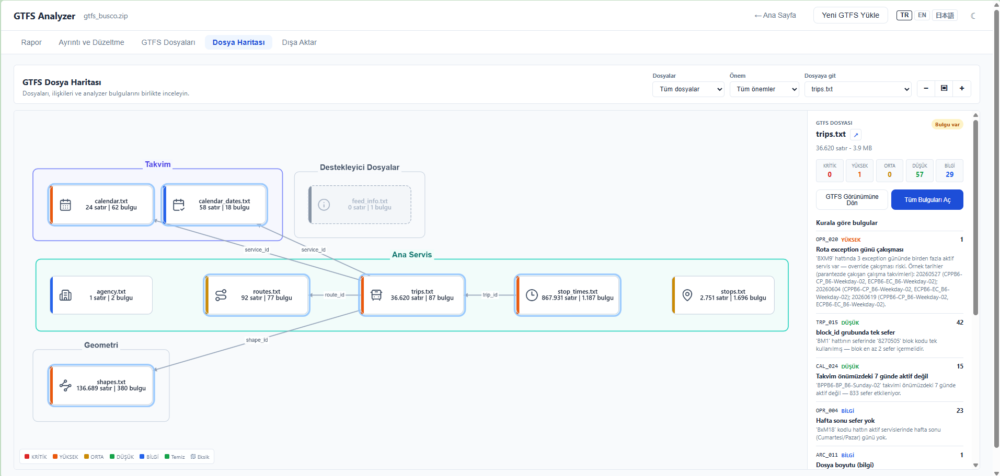

# GTFS Validator & Analyzer

🇹🇷 [Türkçe](README.md) · 🇬🇧 [English](README.en.md) · 🇯🇵 **日本語** · 🇫🇷 [Français](README.fr.md)

[](https://ttezer.github.io/gtfs-analyzer/)
[](https://www.gtfs.jp/)
[](RULES.ja.md)

[](https://crates.io/crates/gtfs-analyzer)
[](https://www.npmjs.com/package/gtfs-sdk)
[](https://pypi.org/project/gtfs-analyzer/)
[](https://github.com/ttezer/gtfs-analyzer/actions/workflows/r.yml)
[](https://chatgpt.com/plugins/plugin_asdk_app_6ac28e6e2354819182f3b14bce32014c)
[](https://claude.ai/customize/plugins/id/13a4a596-abf5-4301-91bc-41425febc400%40anthropic-plugin-directory?via=directory)
[](LICENSE)

**GTFS Validator & Analyzer** は、GTFS ファイルを検証し、フィードの品質を分析するオープンソースの **GTFS バリデーター**です。Web アプリにアップロードした `.zip` はサーバーに送信されず、検証は **WebAssembly** によりユーザーの端末で実行されます。同じ **630 ルール**のエンジンに 9 つの方法でアクセスできます：

| 方法 | 用途 |
|---|---|
| **ブラウザ** ([アプリ](https://ttezer.github.io/gtfs-analyzer/)) | 1 つのフィードを地図とレポートで確認 |
| **CLI**（`cargo install gtfs-analyzer` またはビルド済みバイナリ） | 一括検証、スクリプト、Python 連携 |
| **Rust ライブラリ**（[`gtfs-pipeline`](https://crates.io/crates/gtfs-pipeline)） | 自分の Rust サービスへの組み込み |
| **CI/CD**（終了コード + `--fail-on`） | フィード公開前のパイプラインゲート |
| **[`gtfs-sdk`](https://www.npmjs.com/package/gtfs-sdk) npm パッケージ** | Web または Node アプリへの組み込み |
| **[`gtfs-analyzer`](https://pypi.org/project/gtfs-analyzer/) Python パッケージ**（`pip install gtfs-analyzer`） | Python アプリへの組み込み |
| **`gtfsanalyzer` R パッケージ**（GitHub、`subdir = "r"`） | R からのフィード検証と時刻表バージョンの比較 |
| **ChatGPT — [GTFS Validator](https://chatgpt.com/plugins/plugin_asdk_app_6ac28e6e2354819182f3b14bce32014c)** | 会話内で ZIP または URL を検証し、指摘内容を説明 |
| **Claude — [GTFS Validator](https://claude.ai/customize/plugins/id/13a4a596-abf5-4301-91bc-41425febc400%40anthropic-plugin-directory?via=directory)** | `/gtfs` で ZIP・パス・URL を検証し、指摘内容を説明 |

## 主な特長

- **630 の検証・分析ルール**（39 グループ）。GTFS 仕様の測定可能な規定の **97.2%** をカバーし、フィールド台帳の **300 の要素すべて**に少なくとも 1 つの Spec の根拠があります。全リスト：[`RULES.ja.md`](RULES.ja.md)。
- **ローカルで動作：** ブラウザ、CLI、ライブラリ、npm/Python パッケージはフィードをご自身の端末で処理します。
- **仕様準拠を超えた品質・運行分析：** 異常な速度区間、運行頻度の不整合、孤立した停留所、運行の空白、ネットワーク構造。
- **4 つのクラス、5 つの重大度：** すべての検出結果に Spec · Interop · Quality · Analytics と 致命的 → 情報 が付き、数千件の結果を絞り込み、優先順位を付けられます。
- **2 つのスコア：** 公開可能性を測る **公開スコア** と、4 クラスの加重による **総合スコア**。
- **優先順位付きの修正キュー：** 何から直すべきか、修正がスコアをどれだけ動かすかを示します。
- **すべての検出結果にファイル、行、修正手順。**
- **プランナー向けページ：** 技術レポートを、GTFS を知らないプランナーが読める平易な作業リストに変換します（下記）。
- **地図：** 停留所、shape、便、路線、pathway の問題を実際の shape 形状の上に描きます。
- **GTFS Flex と Fares v2** の検証。フィードが使う GTFS の機能（Shapes、Transfers、Fares、Headsigns、Flex…）を自動検出します。
- **GTFS-JP プロファイル：** 日本の全国プロファイルを自動認識し、v3 と v4 を別々に検証します。
- **出力：** HTML、CSV、JSON、compact JSON、エグゼクティブPDFレポート。実行間の比較。
- **CI/CD ゲート：** `--fail-on` と終了コードで、選んだクラス/重大度でのみパイプラインを止めます。
- **4 つの UI 言語：** トルコ語、英語、日本語、フランス語。

**対象ユーザー**

- **交通事業者・自治体** — フィードを公開する前に検証し、品質上の問題を解消するため。
- **GTFS インテグレーター・コンサルタント** — 納品データの技術的・運用的な品質を文書化するため。
- **アプリケーション開発者** — 利用するフィードの信頼性と統合リスクを評価するため。
- **研究者・アナリスト** — 異なる交通ネットワークをデータ品質と構造の観点で比較するため。

---

## プランナー向け

Web アプリの **プランナー向け** ページは、同じ分析結果を技術レポートではなくプランナーの言葉で伝えます。新しい検出結果は生まず、Analyzer の結果をわかりやすくまとめます。

- **一文の判定：** フィードを公開できるか、公開を妨げる項目がいくつあるか。
- **2 つのリスト：** まず公開を妨げる問題、次に公開を妨げない改善提案 — 優先順位順。
- **項目ごとのカード：** 何か、何をすべきか、**どこで直すか**を、ファイル名や列名ではなく、路線番号、停留所名、発車時刻などプランナーが知っている情報で示します。
- **地図で表示：** 該当する停留所、路線、便を実際の経路形状の上に描きます。
- **5 か国語のカード：** トルコ語、英語、日本語、フランス語、スペイン語。

---

## コーパスでの結果

すべてのリリースは **MobilityDatabase の GTFS Schedule カタログ全体**に対して実行されます。直近の実行（`44623468896`、2026-11-19）：

| | |
|---|---:|
| 試行したフィード | **4,481** |
| 取得できた有効な ZIP | **4,449** |
| 解析完了 | **4,449** （失敗なし） |
| 部分レポート（壊れた/欠けたファイルを安全にスキップ） | 76 |
| 国 | 95 |
| 発火したルール | 423 / 621（以前の測定） |
| フィードあたりの中央値時間 | **0.05 秒** (p90 1.1 秒) |
| フィードあたりのピークメモリ中央値 | **15 MB** (p90 149 MB) |
| 合計時間 | 86.7 分 |

**速度。** カタログ全体、圧縮 GTFS 25.8 GB を 4 コアの CI マシンで **86.7 分**で検証しました：

| 検証時間 | フィード数 | 割合 |
|---|---:|---:|
| 0.1 秒未満 | 2,761 | **62.1%** |
| 1 秒未満 | 3,968 | **89.2%** |
| 10 秒未満 | 4,370 | **98.2%** |
| 1 分未満 | 4,437 | **99.7%** |

**メモリ。** フィードあたりのピークメモリ：**平均 100 MB、中央値 15 MB**。

| ピークメモリ | フィード数 | 割合 |
|---|---:|---:|
| 100 MB 未満 | 3,866 | **86.9%** |
| 500 MB 未満 | 4,281 | **96.2%** |
| 1 GB 未満 | 4,367 | **98.2%** |
| 4 GB 未満 | 4,438 | **99.8%** |

最大級のフィードも数分で完了します：

| フィード | ZIP | 展開後 | 時間 | ピークメモリ |
|---|---:|---:|---:|---:|
| スウェーデン全国（Trafiklab、`mdb-2939`） | 908 MB | 4.5 GB | 2 分 48 秒 | 9.3 GB |
| バーデン＝ヴュルテンベルク（NVBW、`mdb-2393`） | 700 MB | 4.6 GB | 1 分 26 秒 | 7.0 GB |
| ドイツ全国（DELFI、`mdb-3215`） | 589 MB | 4.9 GB | 6 分 1 秒 | 12.9 GB |
| Entur（`mdb-1078`） | 554 MB | 3.4 GB | 1 分 1 秒 | 5.0 GB |
| イギリス全国（BODS、`mdb-2014`） | 1.93 GB | 11.7 GB | 6 分 36 秒 | 13.2 GB |
| チェコ（`mdb-2904`） | 86 MB | 0.85 GB | 58 秒 | 5.5 GB |

これらのフィードの中のテーブルも巨大です。すべての行を読み、検証します：

| フィード | `stop_times` | 便 | shape ポイント | カレンダー例外 | 乗換 | 時間 |
|---|---:|---:|---:|---:|---:|---:|
| ドイツ全国（DELFI、`mdb-3215`） | **6,510 万** | 317 万 | 1,050 万 | 45.6 万 | 107 万 | 6 分 1 秒 |
| スイス全国（SKI+、`mdb-2898`） | **4,260 万** | 262 万 | — | **1,050 万** | 112 万 | 1 分 51 秒 |
| バーデン＝ヴュルテンベルク（NVBW、`mdb-2393`） | 650 万 | 37.3 万 | **5,750 万** | 34 万 | 10.6 万 | 1 分 26 秒 |
| ブエノスアイレス（Colectivos、`mdb-1220`） | **2,930 万** | 43.6 万 | 75.6 万 | 95 | — | 53 秒 |
| ボゴタ（SIMUR、`mdb-3358`） | 960 万 | 18.2 万 | 94.2 万 | 126 | — | 22 秒 |
| イギリス全国（BODS、`mdb-2014`） | **6,950 万** | 176 万 | **8,970 万** | 27.8 万 | — | 6 分 36 秒 |
| チェコ（`mdb-2904`） | 960 万 | 49.4 万 | — | **440 万** | — | 58 秒 |

以前の 621 ルール版では、ブエノスアイレスの 2,930 万行の `stop_times` を 53 秒で検証しました。毎秒およそ **54.8 万行**です。

イギリス全国の BODS フィード、ドイツ全国の DELFI フィード、ヌーヴェル＝アキテーヌの 2 つの地域フィード（77 MB と 83 MB）は、この実行で MobilityData の `gtfs-validator` が内部エラーで途中終了したフィードです。GTFS Analyzer は 4 つとも最後まで検証しました。

**サイズ。** フィードサイズの固定上限はありません。唯一の上限は、zip 爆弾対策として展開後データにかける 16 GB の安全ガードです。ブラウザでは Memory64 対応ブラウザが WASM64 エンジンを使い、上限は端末のメモリで決まります。

カタログ最大のフィード **イギリス全国 BODS**（`mdb-2014`）：11.7 GB のデータと 6,950 万行の `stop_times` を 16 GB の CI マシンで **6.5 分**で最後まで検証します。**ブラウザでも**（Memory64、約 8.5 分、WASM メモリ約 13.6 GB）開けます。

**チェコ**のフィード（`mdb-2904`）は 49.4 万便、107 万件の検出結果を出す本当に壊れたフィードです。**1 分未満**で検証し、**ブラウザでも**開けます。

部分レポートは失敗ではありません。ファイルが ZIP のルートではなくサブフォルダにある（48）、必須ファイルが欠けている（22）、またはジオメトリファイルが安全上限を超える（6）フィードでも、独立したチェックは継続し、スキップしたチェックはレポートに一覧されます。生の結果：[`audit-results/`](audit-results/)。

---

## GTFS-JP 対応

GTFS Analyzer は日本の全国 GTFS プロファイル **GTFS-JP**（国土交通省 / MLIT 標準）を自動認識し、標準 GTFS では任意でも GTFS-JP が必須とするルールを適用します。MLIT は補助金を受ける事業者に GTFS-JP の公開を求めているため、数百の小規模事業者がこのプロファイルに従う必要があります。

- **自動検出：** GTFS-JP 拡張ファイル（`agency_jp.txt`、`office_jp.txt`、`pattern_jp.txt`、旧 `routes_jp.txt`）、`feed_lang=ja`、かな（`ja-Hrkt`）の翻訳、`agency_lang=ja` + `Asia/Tokyo`、または名称フィールドの日本語かなでフィードを GTFS-JP と判定し、レポートに **GTFS-JP** バッジを表示します。
- **プロファイルの選択：** Web アプリでは **分析条件 → GTFS-JP プロファイル範囲**（`Auto`、`V3`、`V4`）、CLI では `--gtfs-jp-profile v3|v4`、SDK では `config: { gtfs_jp_profile: 'v3' }`。この選択はフィードの公式バージョンを判定せず、適用するルール範囲だけを決めます。
- **機械で検証可能な範囲を 100% カバー：** V3 または V4 を明示したとき、機械で検証できる MLIT の規定はすべてルールでカバーされます。人による判断が必要な規定や推奨のみの規定は対象外です。
- **ルール：** プロファイルのルールは **JPN** グループにあり、GTFS-JP フィードでのみ動作します。全リストは [`RULES.ja.md`](RULES.ja.md) にあります。

### プロファイルのモニターと差分ページ

| ページ | 内容 |
|---|---|
| [GTFS-JP Monitor](https://ttezer.github.io/gtfs-jp-monitor/) | 日本のフィードの GTFS-JP プロファイル結果 |
| [GTFS-FR Monitor](https://ttezer.github.io/gtfs-fr-monitor/) | フランスのフィードの結果 |
| [GTFS-JP v3/v4 互換性マトリクス](docs/gtfs-jp-v3-v4-matrix.md) | v3 と v4 のルールの違い |

---

## ChatGPT と Claude：好きな言語で質問、同じ言語で回答

GTFS Validator は ChatGPT と Claude のプラグインとして動作します。チャットにフィードを渡すと、**質問した言語で**結果が返ります。日本語で聞けば日本語で、英語で聞けば英語で答えます。検証とスコアは GTFS Analyzer エンジンが計算し、AI は結果を説明し、優先すべき修正をわかりやすくまとめ、スコアは変更しません。

### ChatGPT — GTFS Validator

ChatGPT の [GTFS Validator のページ](https://chatgpt.com/plugins/plugin_asdk_app_6ac28e6e2354819182f3b14bce32014c)を開き、アプリを追加します。`/gtfs` と入力して GTFS ZIP をアップロードするか、公開フィードの URL を渡すか、`/gtfs TRP_002` のようにルールの意味を尋ねます。

### Claude — GTFS Validator

Claude に [GTFS Validator プラグイン](https://claude.ai/customize/plugins/id/13a4a596-abf5-4301-91bc-41425febc400%40anthropic-plugin-directory?via=directory)を追加します。`/gtfs` と入力して GTFS ZIP を添付するか、ファイルパスや公開フィードの URL を渡すか、`/gtfs TRP_002` のようにルールを尋ねます。プラグインはコード実行を使います。claude.ai ではこれを有効にし、フィードは URL ではなく ZIP で添付してください。

**質問の例：**「このフィードは公開できますか？」「重要な問題を 3 つと、その直し方を説明して」「STP_046 とは何ですか？」

---

## 9 つの利用方法

| 方法 | 始め方 | 詳細 |
|---|---|---|
| ブラウザ | [アプリを開いて](https://ttezer.github.io/gtfs-analyzer/) ZIP をドロップ | [ブラウザ](docs/usage.ja.md#1-ブラウザ) |
| CLI | `cargo install gtfs-analyzer` または[ビルド済みバイナリ](https://github.com/ttezer/gtfs-analyzer/releases) | [CLI](docs/usage.ja.md#2-cli) |
| Rust ライブラリ | `gtfs-pipeline` を依存関係に追加 | [Rust](docs/usage.ja.md#3-rust-ライブラリ) |
| CI/CD | `--fail-on` と終了コード | [CI/CD](docs/usage.ja.md#4-cicd) |
| npm | `npm install gtfs-sdk` | [npm](docs/usage.ja.md#5-gtfs-sdk-npm-パッケージ) |
| Python | `pip install gtfs-analyzer` | [Python](docs/usage.ja.md#6-python-パッケージ) |
| R | `remotes::install_github("ttezer/gtfs-analyzer", subdir = "r")` | [R](docs/usage.ja.md#7-r-パッケージ) |
| ChatGPT | [GTFS Validator](https://chatgpt.com/plugins/plugin_asdk_app_6ac28e6e2354819182f3b14bce32014c)、`/gtfs` | 上記 |
| Claude | [GTFS Validator](https://claude.ai/customize/plugins/id/13a4a596-abf5-4301-91bc-41425febc400%40anthropic-plugin-directory?via=directory)、`/gtfs` | 上記 |

インストールと使い方の詳細：[9 つの利用方法](docs/usage.ja.md)。

---

## 分析基準、スコア、通知の上限

ルールクラスの権威ソース、調整可能なしきい値、**公開スコア**と**総合スコア**の計算方法、大規模フィードでの通知の上限：[分析ドキュメント](docs/analysis.ja.md)。

---

## レポートタブ

### 1. レポート
概要サマリー：両スコア、フィードの指標（路線数、便数、日付範囲など）、および通知の分布チャートが表示されます。

### 2. プランナー向け
同じ結果をプランナーの言葉で示します：公開の判定、まず公開を妨げる問題、次に改善提案。各項目について何か、何をすべきか、どこで直すかを地図とともに示します。詳細は上の **プランナー向け** の節にあります。

### 3. 詳細＆修正
問題は優先度スコア順に並んだ修正キューとして表示されます。各行には次の情報が含まれます：

| 列 | 説明 |
|---|---|
| **スコア** | 優先度スコア — `重大度 × (1 + 依存) × log₂(1 + 件数) / 工数` で算出。高いほど先に修正 |
| **+公開** | このルールを修正した場合の公開スコアの向上量 |
| **+スコア** | このルールを修正した場合の総合スコアの向上量 |
| **依存** | このルールを修正すると自動的にクローズされる他のアクティブなルール数 |
| **工数** | 修正工数：1 = 単一フィールドの変更、2 = 限定的な複数ファイル、3 = 構造的 / データモデルの改訂 |

すべての +公開 値の合計は `100 − 現在の公開スコア` に等しく、すべての +スコア 値の合計は `100 − 現在の総合スコア` に等しくなります。地理的な問題には地図アイコンが表示され、クリックするとインタラクティブな地図上に問題の場所と関連するシェイプ・停留所データが表示されます。**ルールコード**をクリックすると、関連する GTFS 仕様のセクションが新しいタブで開きます — その指摘が最も影響するファイルのリファレンスページ（GTFS-JP ルールでは gtfs.jp）。

### 4. カテゴリ別
グループとクラスごとにすべてのルール違反が一覧表示されます。各行にはルールコード、タイトル、影響を受けたレコード数、重大度、および修正ガイダンスが表示されます。フィルタリングとソートがサポートされています。

### 5. エクスポート
レポートを HTML、CSV、または JSON としてダウンロードできます。PDF オプションはブラウザの印刷ダイアログを開きます —「PDF として保存」でエクスポートしてください。

---

## インタラクティブな GTFS ファイルマップ

GTFS Analyzer には、GTFS のデータ構造を、分析対象フィードの実際の検証結果と組み合わせて表示するインタラクティブなファイルマップが含まれています。

このビューは静的なスキーマ図ではありません。フィードに存在するファイル、欠落しているファイル、検出された問題、および検証済みのファイル間の関係を、分析結果に基づいて表示します。

### 機能

- 7 つの基幹 GTFS ファイルを **カレンダー** と **基幹サービス** のグループに表示
- 基幹以外の標準ファイルは、アナライザーが問題を検出した場合のみ表示
- フィードに含まれる仕様外ファイルを別グループとして一覧表示
- `route_id`、`trip_id`、`stop_id`、`service_id`、`shape_id` などの検証済み GTFS 関係を可視化
- ファイルを最も高い問題の重大度に応じて色分け
- 欠落・正常・問題ありのファイルを区別
- 行数、ファイルサイズ、検出件数、重大度の分布を表示
- 検出結果をルールごとに、常に **致命的 → 高 → 中 → 低 → 情報** の順で一覧表示
- 選択したファイルのすべての検出結果を、フィルタ済みの「詳細＆修正」ビューで開く
- ファイルの有無と重大度のフィルタを提供
- ズーム、画面に合わせる、ダークテーマ、モバイルレイアウトに対応

ファイルを選択すると、検証済みかつ関連する GTFS の接続のみが展開されます。仕様外ファイルは表示されたままですが、検証されていない関係は描画されません。

分析と可視化はすべてブラウザ内で実行されます。GTFS ファイルがサーバーにアップロードされることはありません。



---

## 実行間の比較

GTFS Analyzer は、同じフィードの 2 つの解析（前／後）を比較し、修正によって何が改善され、何が悪化したかを示します。**比較**タブを開き、以前の解析からダウンロードした **Golden JSON** をアップロードしてください。差分は現在の実行と比較して計算されます。

### 機能

- 公開・総合・サブスコア（仕様、相互運用、品質、分析）の前後変化を表示
- 各ルールを **修正済み・減少・増加・新規・同一** に分類し、フィルターと検索を提供
- 重大度（重大 → 情報）とクラス（仕様／相互運用／品質／分析）の分布変化を表示
- フィード構造（trip・stop・`stop_times`・`calendar_dates` の行数）とフィード／サービス期間を比較
- 通知密度を **1,000 trip あたり**および **100,000 stop_time あたり**に正規化し、規模の異なるフィードを比較可能に
- 2 つの実行がフィード名・期間・設定で異なる場合に警告し、誤解を招く差分の読み違いを防止
- 比較を CSV としてエクスポート
- 旧 Golden スキーマ（v1〜v3）も読み込み可能

比較は完全にブラウザ内で実行されます。Golden JSON はローカルで解析され、サーバーには一切アップロードされません。

---

## ルールクラス

| クラス | 測定内容 | 影響するスコア |
|---|---|---|
| **仕様** | GTFS 仕様からの逸脱 — 必須フィールドの欠落、無効な値、参照整合性エラー | 公開（致命的のみ）と総合 |
| **相互運用** | 仕様準拠だが、一般的なコンシューマー（Google Maps、Apple Maps など）に拒否または誤解釈される問題 | 総合（相互運用スコア） |
| **品質** | オプションだが期待されるフィールドの欠落、不整合、ベストプラクティスからの逸脱 | 総合スコア |
| **分析** | サービスパターン分析 — 過密、疎なサービス、期限切れサービス | 総合スコア |

---

## 重大度レベル

| レベル | 意味 |
|---|---|
| **致命的** | フィードを使用不可にする、またはデータ損失を引き起こす |
| **高** | 重大な機能的問題；強く修正を推奨 |
| **中** | 注意が必要な不整合 |
| **低** | ベストプラクティスからの軽微な逸脱 |
| **情報** | 情報提供のみ；対応が不要な場合もある |

重大度は、[GTFS Schedule Reference](https://gtfs.org/documentation/schedule/reference/#file-requirements) のファイル/フィールド要件レベル（Required・Conditionally Required・Recommended・Optional）と、違反のsemantic impactを組み合わせて決定します。

### Spec 重大度の基準

Spec の重大度は、要件レベルとsemantic impactの組み合わせ、つまり違反が GTFS データの利用可能性に及ぼす影響で決まります。

- **致命的:** 必須ファイル/フィールド、主キー・外部キー整合性、または中核的な型/範囲の違反。フィードを信頼して利用できず、`Spec + 致命的` は公開ゲートになる。
- **高:** フィードを解析できても、運行、運賃、アクセシビリティ、Flex/pathway の意味を大きく変える直接的な規範違反。
- **中:** 主データモデルを読み取れる範囲で、影響が限定された、または条件付きの規範違反。
- **低:** 影響範囲が狭いメタデータ/オプション項目の規範上の逸脱。公開をブロックしない。
- **情報:** 規範上の Spec 違反には使用せず、測定または文脈シグナル専用。

したがって `Spec` ルールに `情報` の重大度はありません。

GTFS-JP フィードの場合、**JPN** グループのルールは公式の [GTFS-JP 仕様](https://www.gtfs.jp/)（gtfs.jp）に基づいています。

---

---

## ルールグループ

各ルールは `GROUP_NNN` 形式でコード化されています。グループは GTFS のファイルおよびコンポーネントの境界に従っています。

| グループ | GTFS コンポーネント | 説明 |
|---|---|---|
| **ARC** | アーカイブ・ファイルレベル | ZIP 展開、ファイル形式、必須ファイルの存在、文字エンコーディング |
| **AGN** | `agency.txt` | 交通事業者情報と複数事業者の一貫性 |
| **CAL** | `calendar.txt` | サービスカレンダーと週次曜日パターン |
| **CLD** | `calendar_dates.txt` | サービス例外日と日付の有効性 |
| **STP** | `stops.txt` | 停留所の位置、階層、アクセシビリティ情報 |
| **RTS** | `routes.txt` | 路線定義、路線タイプ、色、命名 |
| **TRP** | `trips.txt` | 便定義、ブロックとシェイプの関連付け |
| **STM** | `stop_times.txt` | 停留所の時刻、速度、シーケンス、時刻の一貫性 |
| **SHP** | `shapes.txt` | 経路シェイプ、ポイント順序、停留所との整合性 |
| **FRQ** | `frequencies.txt` | 頻度ベースの便と運行間隔値 |
| **TRF** | `transfers.txt` | 乗換定義、タイプ、所要時間の有効性 |
| **FAR** | `fare_attributes.txt` | 運賃定義、通貨、支払方法 |
| **FRL** | `fare_rules.txt` | 路線・ゾーンベースの運賃ルール |
| **FIN** | `feed_info.txt` | フィード発行者情報、言語、有効期間 |
| **LIC** | `licenses.txt` | フィード全体およびファイル別のライセンス宣言 |
| **PTH** | `pathways.txt` | 駅構内の通路ネットワークとアクセシビリティ接続 |
| **LVL** | `levels.txt` | 駅のフロアとエレベーター・階段の関係 |
| **TRN** | `translations.txt` | フィールドの翻訳と言語の一貫性 |
| **ATR** | `attributions.txt` | データソースと帰属情報 |
| **XFL** | クロスファイル | ファイル横断の参照整合性と一貫性 |
| **GEO** | 地理的分析 | 座標の一貫性、外れ値の検出、クラスタリング |
| **OPR** | 運用分析 | 便間の待機時間、路線密度、停留所の繰り返し |
| **VAT** | ネットワークトポロジー | 孤立した停留所、接続されていない路線、ネットワークアクセシビリティ |
| **DQ** | フィード全体の品質 | 一般的なデータ品質指標としきい値チェック |
| **RCT** | `rider_categories.txt` | 利用者カテゴリ、年齢範囲、デフォルトカテゴリ（Fares v2） |
| **FMD** | `fare_media.txt` | 支払媒体：物理カード、モバイルアプリ、EMV など（Fares v2） |
| **FPD** | `fare_products.txt` | 運賃商品、金額、通貨、媒体・カテゴリの関連付け（Fares v2） |
| **FLG** | `fare_leg_rules.txt` | 区間ごとの運賃ルールと優先度（Fares v2） |
| **FLJ** | `fare_leg_join_rules.txt` | 乗り継ぎで2つの区間を1つの実効運賃区間として扱う結合ルール（Fares v2） |
| **FTR** | `fare_transfer_rules.txt` | 乗換運賃ルールと時間制限（Fares v2） |
| **ARS** | `areas.txt` | 地理的エリア定義（Fares v2） |
| **SAR** | `stop_areas.txt` | 停留所とエリアのマッピング（Fares v2） |
| **NET** | `networks.txt` | ネットワーク定義（Fares v2） |
| **TFR** | `timeframes.txt` | 時間帯グループとサービスカレンダーの関連付け（Fares v2） |
| **BKR** | `booking_rules.txt` | デマンド型交通の予約ルール、事前通知ウィンドウ、予約タイプ（GTFS Flex） |
| **PDW** | Flex ウィンドウルール | `stop_times.txt` におけるデマンド型交通の乗降時間ウィンドウの一貫性（GTFS Flex） |
| **LOC** | `locations.geojson` | 柔軟サービスゾーンのジオメトリと形式の検証（GTFS Flex） |
| **GGL** | Google Transit 固有 | Google Maps および Google Transit が追加で要求または制限するルール |
| **JPN** | GTFS-JP プロファイル | 日本の GTFS-JP プロファイルルール — カナ読み、`office_jp.txt`・`agency_jp.txt` の参照整合性（GTFS-JP フィードのみ） |

---

## 開発者セットアップ

### 必要環境

- **Rust** — GNU ツールチェーン（`stable-x86_64-pc-windows-gnu`）、MinGW gcc
- **wasm-pack** — WASM ビルドツール
- **Node.js** — メンテナンス中の LTS リリース（正確な範囲は `ui/package.json` の `engines` を参照）

> **Windows の注意：** MSVC の代わりに GNU ツールチェーンが必要です。WASM ビルド時に `wasm-opt` がダウンロードされますが、このステップは MSVC リンカーと非互換です。MinGW の `gcc` が PATH に含まれている必要があります。

```powershell
# Rust GNU ツールチェーン（初回のみ）
rustup toolchain install stable-x86_64-pc-windows-gnu
rustup override set stable-x86_64-pc-windows-gnu
```

### ビルド

```powershell
# 1. 依存関係のインストール
cd ui
npm install

# 2. WASM のコンパイル
npm run wasm

# 3. UI のコンパイル
npm run build
# 出力先: ui/dist/
```

### 開発サーバー

```powershell
cd ui
npm install
npm run dev
```

### テスト

```powershell
# Rust ユニットテストと統合テスト
cargo test

# workspace の全 crate・test・example target に対する警告ブロック lint
cargo clippy --workspace --all-targets --all-features -- -D warnings

# Playwright スモークテスト
cd ui
npx playwright test
```

## プロジェクト構成

```
gtfs-validator/
├── crates/
│   ├── config/     # 設定型
│   ├── core/       # 共有データ構造と結果モデル
│   ├── pipeline/   # 検証パイプライン（k1〜k7 ステージ）
│   ├── rules/      # ルール定義とレジストリ（630 ルール、39 グループ）
│   └── wasm/       # wasm-bindgen WASM 出力
├── spec-audit/     # 仕様から生成したフィールド表（アンカー検査）
└── ui/             # Vite + TypeScript フロントエンド
    ├── pkg/          # wasm-pack 出力（生成済み、コミット済み）
    ├── src/
    │   └── pages/    # アプリケーションタブ（domain/fix/rules/export）
    └── tests/        # Playwright テスト
```

## 謝辞

一般社団法人日本バス情報協会 専務理事 **西澤明**様：GTFS-JP 対応の改善へのご支援と、
貴重なお時間を割いてくださったことに心より御礼申し上げます。

## ライセンス

MIT — 詳細は [LICENSE](LICENSE) をご参照ください。
