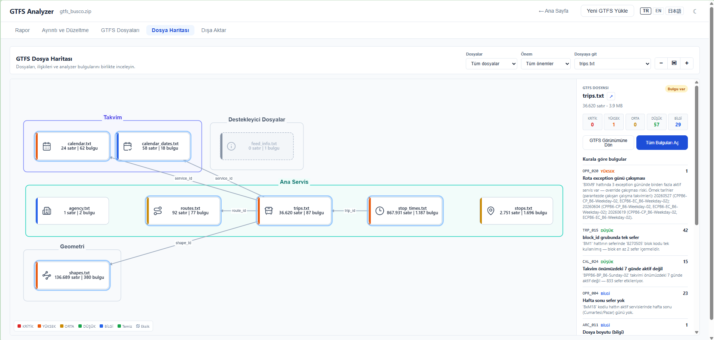

# GTFS Validator & Analyzer

🇹🇷 **Türkçe** · 🇬🇧 [English](README.en.md) · 🇯🇵 [日本語](README.ja.md) · 🇫🇷 [Français](README.fr.md)

[](https://ttezer.github.io/gtfs-analyzer/)
[](https://www.gtfs.jp/)
[](RULES.md)

[](https://crates.io/crates/gtfs-analyzer)
[](https://www.npmjs.com/package/gtfs-sdk)
[](https://pypi.org/project/gtfs-analyzer/)
[](https://chatgpt.com/plugins/plugin_asdk_app_6ac28e6e2354819182f3b14bce32014c)
[](https://claude.ai/customize/plugins/id/13a4a596-abf5-4301-91bc-41425febc400%40anthropic-plugin-directory?via=directory)
[](LICENSE)

**GTFS Validator & Analyzer**, GTFS dosyalarını doğrulayan ve feed kalitesini analiz eden açık kaynak bir **GTFS validator**'dür. Web uygulamasına yüklenen `.zip` hiçbir sunucuya gönderilmez; doğrulama **WebAssembly** ile kullanıcının cihazında çalışır. Aynı **630 kurallı** motora sekiz farklı yoldan erişilir:

| Yol | Ne için |
|---|---|
| **Tarayıcı** ([uygulama](https://ttezer.github.io/gtfs-analyzer/)) | tek feed'i açıp haritayla incelemek |
| **CLI** (`cargo install gtfs-analyzer` ya da hazır binary) | toplu doğrulama, betikleme, Python entegrasyonu |
| **Rust kütüphanesi** ([`gtfs-pipeline`](https://crates.io/crates/gtfs-pipeline)) | doğrulamayı kendi Rust servisinize gömmek |
| **CI/CD** (exit kodu + `--fail-on`) | feed yayına çıkmadan önce pipeline kapısı |
| **[`gtfs-sdk`](https://www.npmjs.com/package/gtfs-sdk) npm paketi** | kendi web veya Node uygulamanıza gömmek |
| **`gtfs-analyzer` Python paketi** (`pip install gtfs-analyzer`) | Python uygulamasına doğrulama gömmek |
| **ChatGPT — [GTFS Validator](https://chatgpt.com/plugins/plugin_asdk_app_6ac28e6e2354819182f3b14bce32014c)** | ZIP veya URL'yi sohbet içinde doğrulatmak ve bulguları açıklatmak |
| **Claude — [GTFS Validator](https://claude.ai/customize/plugins/id/13a4a596-abf5-4301-91bc-41425febc400%40anthropic-plugin-directory?via=directory)** | `/gtfs` ile ZIP, yol veya URL doğrulatmak ve bulguları açıklatmak |

## Önemli Özellikler

- **630 doğrulama ve analiz kuralı**, 39 grupta; GTFS spesifikasyonunun ölçülebilir hükümlerinin **%97,2'si** karşılanır, alan tablosunun **300 atomunun 300'ü** en az bir Spec çapası taşır. Tam liste: [`RULES.md`](RULES.md).
- **Yerel çalışma:** tarayıcı, CLI, kütüphaneler ve npm/Python paketleri feed'i kendi cihazınızda işler.
- **Spec uyumunun ötesinde kalite ve operasyon analizi:** anormal hız segmentleri, sefer sıklığı tutarsızlıkları, izole duraklar, servis boşlukları, ağ topolojisi.
- **Dört sınıf, beş önem seviyesi:** her bulgu Spec · Interop · Quality · Analytics sınıfı ve Kritik → Bilgi önemiyle etiketlenir; binlerce bulgu filtrelenip önceliklendirilebilir.
- **İki skor:** yayınlanabilirliği ölçen **Yayın Skoru** ve dört sınıfın ağırlıklı **Genel Skoru**.
- **Önceliklendirilmiş düzeltme kuyruğu:** hangi sorunun önce ele alınacağını ve düzeltmenin skora olası etkisini gösterir.
- **Her bulgu için dosya, satır ve düzeltme adımı.**
- **Planlamacılar İçin sayfası:** teknik raporu, GTFS bilmeyen planlamacının okuyacağı sade dilli bir iş listesine çevirir (aşağıda).
- **Harita:** durak, güzergâh, sefer, hat ve pathway sorunları gerçek shape geometrisi üzerinde gösterilir.
- **GTFS Flex ve Fares v2** doğrulaması; feed'in kullandığı özellikler (Shapes, Transfers, Fares, Headsigns, Flex…) otomatik tespit edilir.
- **GTFS-JP profili:** Japonya'nın ulusal profili otomatik tanınır, v3 ve v4 ayrı denetlenir.
- **Çıktılar:** HTML, CSV, JSON, compact JSON ve Yönetici PDF Raporu; çalıştırmalar arası karşılaştırma.
- **CI/CD kapısı:** `--fail-on` ve exit kodlarıyla yalnız istediğiniz sınıf/önemde pipeline'ı durdurur.
- **Dört arayüz dili:** Türkçe, İngilizce, Japonca, Fransızca.

**Kimler için?**

- **Toplu taşıma işletmecileri ve belediyeler** — Feed'i yayına almadan önce doğrulamak ve kalite sorunlarını gidermek için.
- **GTFS entegratörleri ve danışmanlar** — Teslim edilen verinin teknik ve operasyonel kalitesini belgelemek için.
- **Uygulama geliştiriciler** — Kullandıkları feed'in güvenilirliğini ve entegrasyon risklerini değerlendirmek için.
- **Araştırmacılar ve analistler** — Farklı toplu taşıma ağlarını veri kalitesi ve yapı bakımından karşılaştırmak için.

---

## Planlamacılar İçin

Web uygulamasındaki **Planlamacılar İçin** sayfası, aynı analiz sonucunu teknik rapor yerine planlamacının diliyle anlatır; yeni bulgu üretmez, Analyzer'ın sonucunu sadeleştirir.

- **Tek cümlelik karar:** feed yayınlanabilir mi, kaç konu yayını engelliyor.
- **İki liste:** önce yayını engelleyen sorunlar, sonra yayını engellemeyen iyileştirme önerileri — öncelik sırasıyla.
- **Her konu için kart:** ne olduğu, ne yapılacağı ve **nerede düzeltileceği**; dosya ve sütun adı yerine hat kodu, durak adı, sefer saati gibi planlamacının tanıdığı bilgilerle.
- **Haritada gösterim:** sorunlu durak, hat ve seferler gerçek güzergâh geometrisi üzerinde çizilir.
- **Beş dilde kartlar:** Türkçe, İngilizce, Japonca, Fransızca ve İspanyolca.

---

## Korpus Sonuçlarımız

Her sürüm, **MobilityDatabase'in tüm GTFS Schedule kataloğuna** karşı koşturulur. Son koşum (`44623468896`, 2026-11-19):

| | |
|---|---:|
| Denenen feed | **4.481** |
| İndirilen geçerli ZIP | **4.449** |
| Analizi tamamlanan | **4.449** (hatasız) |
| Kısmi rapor (bozuk/eksik dosya güvenle atlandı) | 76 |
| Ülke | 95 |
| Tetiklenen kural | 423 / 621 (önceki ölçüm) |
| Medyan süre / feed | **0,05 sn** (p90 1,1 sn) |
| Medyan tepe bellek / feed | **15 MB** (p90 149 MB) |
| Toplam süre | 86,7 dk |

**Hız.** 25,8 GB'lık sıkıştırılmış GTFS'in tamamı 4 çekirdekli bir CI makinesinde **86,7 dakikada** doğrulandı:

| Doğrulama süresi | Feed sayısı | Oran |
|---|---:|---:|
| 0,1 saniyenin altında | 2.761 | **%62,1** |
| 1 saniyenin altında | 3.968 | **%89,2** |
| 10 saniyenin altında | 4.370 | **%98,2** |
| 1 dakikanın altında | 4.437 | **%99,7** |

**Bellek.** Feed başına tepe bellek: **ortalama 100 MB, medyan 15 MB**.

| Tepe bellek | Feed sayısı | Oran |
|---|---:|---:|
| 100 MB'ın altında | 3.866 | **%86,9** |
| 500 MB'ın altında | 4.281 | **%96,2** |
| 1 GB'ın altında | 4.367 | **%98,2** |
| 4 GB'ın altında | 4.438 | **%99,8** |

En büyük feed'ler de birkaç dakikada tamamlanıyor:

| Feed | ZIP | Açılmış | Süre | Tepe bellek |
|---|---:|---:|---:|---:|
| İsveç geneli (Trafiklab, `mdb-2939`) | 908 MB | 4,5 GB | 2 dk 48 sn | 9,3 GB |
| Baden-Württemberg (NVBW, `mdb-2393`) | 700 MB | 4,6 GB | 1 dk 26 sn | 7,0 GB |
| Almanya geneli (DELFI, `mdb-3215`) | 589 MB | 4,9 GB | 6 dk 1 sn | 12,9 GB |
| Entur (`mdb-1078`) | 554 MB | 3,4 GB | 1 dk 1 sn | 5,0 GB |
| İngiltere geneli (BODS, `mdb-2014`) | 1,93 GB | 11,7 GB | 6 dk 36 sn | 13,2 GB |
| Çekya (`mdb-2904`) | 86 MB | 0,85 GB | 58 sn | 5,5 GB |

Bu feed'lerin içindeki tablolar da çok büyük; satırların tamamı okunup denetleniyor:

| Feed | `stop_times` | Sefer | Shape noktası | Takvim istisnası | Aktarma | Süre |
|---|---:|---:|---:|---:|---:|---:|
| Almanya geneli (DELFI, `mdb-3215`) | **65,1 milyon** | 3,17 milyon | 10,5 milyon | 456 bin | 1,07 milyon | 6 dk 1 sn |
| İsviçre geneli (SKI+, `mdb-2898`) | **42,6 milyon** | 2,62 milyon | — | **10,5 milyon** | 1,12 milyon | 1 dk 51 sn |
| Baden-Württemberg (NVBW, `mdb-2393`) | 6,5 milyon | 373 bin | **57,5 milyon** | 340 bin | 106 bin | 1 dk 26 sn |
| Buenos Aires (Colectivos, `mdb-1220`) | **29,3 milyon** | 436 bin | 756 bin | 95 | — | 53 sn |
| Bogotá (SIMUR, `mdb-3358`) | 9,6 milyon | 182 bin | 942 bin | 126 | — | 22 sn |
| İngiltere geneli (BODS, `mdb-2014`) | **69,5 milyon** | 1,76 milyon | **89,7 milyon** | 278 bin | — | 6 dk 36 sn |
| Çekya (`mdb-2904`) | 9,6 milyon | 494 bin | — | **4,4 milyon** | — | 58 sn |

Önceki 621 kurallı sürüm, Buenos Aires'in 29,3 milyon `stop_times` satırını 53 saniyede doğruladı: saniyede yaklaşık **548 bin satır**.

İngiltere geneli BODS, Almanya geneli DELFI ve Nouvelle-Aquitaine'in iki bölgesel feed'i (77 ve 83 MB), MobilityData'nın `gtfs-validator`'ının bu koşumda iç hatayla yarıda bıraktığı feed'lerdendir; GTFS Analyzer dördünü de sonuna kadar doğruladı.

**Boyut.** Sabit bir feed boyutu sınırı yok. Tek üst sınır, zip bombalarına karşı açılmış veri için konan 16 GB'lık güvenlik korumasıdır; tarayıcıda Memory64 destekleyen tarayıcılarda WASM64 motoru kullanılır ve sınırı cihazın belleği belirler.

Kataloğun en büyük feed'i **İngiltere geneli BODS** (`mdb-2014`): 11,7 GB'lık veri ve 69,5 milyon `stop_times` satırı 16 GB'lık bir CI makinesinde **6,5 dakikada** baştan sona doğrulanır; **tarayıcıda da** (Memory64, ~8,5 dakika, ~13,6 GB WASM belleği) açılır.

**Çekya** feed'i (`mdb-2904`), 494 bin seferli ve 1,07 milyon bulgu üreten gerçekten bozuk bir feed: **1 dakikanın altında** doğrulanır, **tarayıcıda da** açılır.

Kısmi raporlar hata değildir: dosyaları ZIP kökü yerine alt klasörde olan (48), zorunlu dosyası eksik (22) veya geometri dosyası güvenlik sınırını aşan (6) feed'lerde bağımsız kontroller sürer ve atlanan kontroller raporda listelenir. Ham sonuçlar: [`audit-results/`](audit-results/).

---

## GTFS-JP Desteği

GTFS Analyzer, Japonya'nın ulusal GTFS profili **GTFS-JP**'yi (国土交通省 / MLIT standardı) otomatik olarak tanır ve standart GTFS'in isteğe bağlı bıraktığı, GTFS-JP'nin zorunlu kıldığı kuralları uygular. MLIT, sübvansiyon alan işletmecilerden GTFS-JP yayımlamasını şart koştuğu için yüzlerce küçük operatör bu profile uymak zorundadır.

- **Otomatik tespit:** GTFS-JP uzantı dosyaları (`agency_jp.txt`, `office_jp.txt`, `pattern_jp.txt`, eski `routes_jp.txt`), `feed_lang=ja`, kana (`ja-Hrkt`) çevirileri, `agency_lang=ja` + `Asia/Tokyo` ya da ad alanlarındaki Japonca kana feed'i GTFS-JP olarak işaretler; raporda **GTFS-JP** rozeti görünür.
- **Profil seçimi:** web uygulamasında **Analiz Kriterleri → GTFS-JP profil kapsamı** (`Auto`, `V3`, `V4`); CLI'da `--gtfs-jp-profile v3|v4`; SDK'da `config: { gtfs_jp_profile: 'v3' }`. Seçim feed'in resmî sürümünü tespit etmez, yalnız uygulanacak kural kapsamını belirler.
- **%100 makineyle denetlenebilir kapsam:** açıkça seçilen V3 veya V4 profilinde, makineyle denetlenebilir MLIT hükümlerinin tamamı kurallarla karşılanır; insan yorumu gerektiren ve yalnızca öneri niteliğindeki hükümler kapsam dışıdır.
- **Kurallar:** profil kuralları **JPN** grubundadır ve yalnız GTFS-JP feed'lerinde çalışır; tam liste [`RULES.md`](RULES.md) içinde.

### Profil izleme ve fark sayfaları

| Sayfa | Ne gösterir |
|---|---|
| [GTFS-JP Monitor](https://ttezer.github.io/gtfs-jp-monitor/) | Japon feed'lerinin GTFS-JP profil sonuçları |
| [GTFS-FR Monitor](https://ttezer.github.io/gtfs-fr-monitor/) | Fransız feed'lerinin sonuçları |
| [GTFS-JP v3/v4 uyumluluk matrisi](docs/gtfs-jp-v3-v4-matrix.md) | v3 ile v4 arasındaki kural farkları |

---

## ChatGPT ve Claude: İstediğiniz Dilde Sorun, İstediğiniz Dilde Yanıt

GTFS Validator, ChatGPT'de ve Claude'da eklenti olarak çalışır. Feed'inizi sohbete verin, **hangi dilde sorarsanız o dilde** sonuç alın: Türkçe sorana Türkçe, Japonca sorana Japonca yanıt verir. Doğrulamayı ve skorları GTFS Analyzer motoru hesaplar; yapay zekâ sonucu açıklar, öncelikli düzeltmeleri anlaşılır biçimde özetler ve skorları değiştirmez.

### ChatGPT — GTFS Validator

ChatGPT'nin [GTFS Validator sayfasını](https://chatgpt.com/plugins/plugin_asdk_app_6ac28e6e2354819182f3b14bce32014c) açıp uygulamayı ekleyin. `/gtfs` yazıp bir GTFS ZIP yükleyin, herkese açık bir feed URL'si verin veya `/gtfs TRP_002` gibi bir kuralın ne anlama geldiğini sorun.

### Claude — GTFS Validator

Claude'da [GTFS Validator eklentisini](https://claude.ai/customize/plugins/id/13a4a596-abf5-4301-91bc-41425febc400%40anthropic-plugin-directory?via=directory) ekleyin. `/gtfs` yazıp bir GTFS ZIP ekleyin, bir dosya yolu ya da herkese açık bir feed URL'si verin veya `/gtfs TRP_002` gibi bir kuralı sorun. Eklenti kod çalıştırma özelliğini kullanır; claude.ai'de bu özelliğin açık olması gerekir ve orada feed'i URL yerine ZIP olarak ekleyin.

**Örnek sorular:** "Bu feed yayına hazır mı?", "En önemli üç sorunu ve nasıl düzelteceğimi anlat", "STP_046 ne demek?"

---

## Sekiz Yolu Kullanmak

| Yol | Nasıl başlanır | Ayrıntı |
|---|---|---|
| Tarayıcı | [Uygulamayı açın](https://ttezer.github.io/gtfs-analyzer/), ZIP'i sürükleyip bırakın | [Tarayıcı](docs/usage.tr.md#1-tarayıcı) |
| CLI | `cargo install gtfs-analyzer` ya da [hazır binary](https://github.com/ttezer/gtfs-analyzer/releases) | [CLI](docs/usage.tr.md#2-cli) |
| Rust kütüphanesi | `gtfs-pipeline` bağımlılığı | [Rust](docs/usage.tr.md#3-rust-kütüphanesi) |
| CI/CD | `--fail-on` ve exit kodları | [CI/CD](docs/usage.tr.md#4-cicd) |
| npm | `npm install gtfs-sdk` | [npm](docs/usage.tr.md#5-gtfs-sdk-npm-paketi) |
| Python | `pip install gtfs-analyzer` | [Python](docs/usage.tr.md#6-python-paketi) |
| ChatGPT | [GTFS Validator](https://chatgpt.com/plugins/plugin_asdk_app_6ac28e6e2354819182f3b14bce32014c), `/gtfs` | yukarıda |
| Claude | [GTFS Validator](https://claude.ai/customize/plugins/id/13a4a596-abf5-4301-91bc-41425febc400%40anthropic-plugin-directory?via=directory), `/gtfs` | yukarıda |

Tüm kurulum ve kullanım ayrıntıları: [Sekiz yolu kullanmak](docs/usage.tr.md).

---

## Analiz Kriterleri, Skorlar ve Bulgu Sınırları

Kural sınıflarının otorite kaynağı, ayarlanabilir eşikler, **Yayın Skoru** ile **Genel Skor**'un nasıl hesaplandığı ve büyük feed'lerde bulgu sınırları: [analiz belgesi](docs/analysis.tr.md).

---

## Rapor Sekmeleri

### 1. Rapor
Genel özet: iki skor, feed metrikleri (hat sayısı, sefer sayısı, tarih aralığı vb.) ve sorun dağılım grafiği.

### 2. Planlamacılar İçin
Aynı sonucun planlamacı diliyle anlatımı: yayın kararı, önce yayını engelleyen sorunlar, sonra iyileştirme önerileri; her konu için ne olduğu, ne yapılacağı ve nerede düzeltileceği, haritayla birlikte. Ayrıntılar yukarıdaki **Planlamacılar İçin** bölümünde.

### 3. Ayrıntı ve Düzeltme
Bulunan sorunlar öncelik puanına göre sıralanmış bir düzeltme kuyruğu olarak sunulur. Her satır şu bilgileri içerir:

| Sütun | Açıklama |
|---|---|
| **Skor** | Öncelik puanı — `Ciddiyet × (1 + Bağımlı) × log₂(1 + Etkilenen) / Çaba` formülüyle hesaplanır; yüksek = önce düzelt |
| **+Yayın** | Bu kural düzeltilirse Yayın Skoru kaç puan artar |
| **+Skor** | Bu kural düzeltilirse Genel Skor kaç puan artar |
| **Bağımlı** | Bu kural giderilince kaç başka kural otomatik kapanır |
| **Çaba** | Düzeltme iş yükü: 1 = tek alan değişikliği, 2 = sınırlı çapraz-dosya, 3 = yapısal / veri modeli revizyonu |

Tüm satırların +Yayın toplamı `100 − mevcut Yayın Skoru`na, +Skor toplamı `100 − mevcut Genel Skor`a eşittir. Coğrafi sorunlarda harita ikonu görünür; tıklandığında sorunlu noktalar ve ilgili şekil/durak verileri interaktif haritada gösterilir. **Kural kodu**na tıklandığında ilgili GTFS spesifikasyon bölümü yeni sekmede açılır — bulgunun en çok etkilediği dosyanın referans sayfası (GTFS-JP kurallarında gtfs.jp).

### 4. Kategori Bazlı
Tüm kural ihlalleri grup ve sınıfa göre listelenir. Her satırda kural kodu, başlık, etkilenen kayıt sayısı, önem seviyesi ve düzeltme önerisi yer alır. Filtreleme ve sıralama desteklenir.

### 5. Dışa Aktar
Raporu HTML, CSV veya JSON olarak indirir. PDF seçeneği tarayıcının yazdırma diyaloğunu açar — "PDF olarak kaydet" ile kaydedebilirsiniz.

---

## İnteraktif GTFS Dosya Haritası

GTFS Validator & Analyzer, GTFS veri yapısını analiz edilen feed'in gerçek doğrulama bulgularıyla birleştiren interaktif bir Dosya Haritası içerir.

Bu görünüm statik bir şema değildir. Feed'de bulunan dosyaları, eksikleri, bulguları ve doğrulanmış dosya ilişkilerini analiz sonucuna göre gösterir.

### Özellikler

- Yedi çekirdek GTFS dosyasını **Takvim** ve **Ana Servis** gruplarında gösterir
- Çekirdek dışındaki standart dosyaları yalnızca analyzer bulgusu varsa gösterir
- Feed'de bulunan spec dışı dosyaları ayrı bir grupta listeler
- `route_id`, `trip_id`, `stop_id`, `service_id` ve `shape_id` gibi doğrulanmış GTFS ilişkilerini görselleştirir
- Dosyaları en yüksek bulgu önemine göre renklendirir
- Eksik, temiz ve sorunlu dosyaları birbirinden ayırır
- Satır sayısı, dosya boyutu, bulgu sayısı ve önem dağılımını gösterir
- Bulguları kurala göre ve **Kritik → Yüksek → Orta → Düşük → Bilgi** sırasıyla listeler
- Seçilen dosyanın tüm bulgularını filtrelenmiş Ayrıntı ve Düzeltme ekranında açar
- Dosya varlığı ve önem filtreleri sunar
- Yakınlaştırma, ekrana sığdırma, koyu tema ve mobil görünümü destekler

Bir dosya seçildiğinde yalnızca doğrulanmış ve ilgili GTFS bağlantıları açılır. Spec dışı dosyalar görünür tutulur ancak doğrulanmamış ilişkiler çizilmez.

Analiz ve görselleştirme tamamen tarayıcı içinde çalışır. GTFS dosyaları herhangi bir sunucuya yüklenmez.



---

## Çalıştırmalar Arası Karşılaştırma

GTFS Validator & Analyzer, aynı feed'in iki analizini (önce/sonra) karşılaştırarak bir düzeltme turunun neyi iyileştirdiğini, neyi bozduğunu gösterir. Önceki analizden indirdiğiniz **Golden JSON**'u **Karşılaştır** sekmesinden yükleyin; karşılaştırma mevcut çalışmaya göre yapılır.

### Özellikler

- Yayın, Genel ve alt skorların (Spec, Interop, Quality, Analytics) önce/sonra değişimini gösterir
- Her kuralı **Düzeltilen, Azalan, Artan, Yeni, Aynı** olarak sınıflandırır; filtre ve arama sunar
- Önem (Kritik → Bilgi) ve sınıf (Spec/Interop/Quality/Analytics) dağılımındaki değişimi gösterir
- Feed yapısı değişimini (sefer, durak, `stop_times` ve `calendar_dates` satır sayıları) ve feed/servis tarih aralıklarını karşılaştırır
- Notice yoğunluğunu **1.000 sefer** ve **100.000 stop_time** başına normalize eder — böylece farklı boyuttaki feed'ler kıyaslanabilir
- İki çalışma feed adı, tarih aralığı veya yapılandırma (config) bakımından farklıysa uyarır; böylece yanıltıcı bir fark yanlış okunmaz
- Karşılaştırmayı CSV olarak dışa aktarır
- Eski Golden şemalarını (v1–v3) da okur

Karşılaştırma tamamen tarayıcı içinde çalışır. Golden JSON tarayıcıda çözümlenir; hiçbir veri sunucuya yüklenmez.

---

## Kural Sınıfları

| Sınıf | Ne ölçer | Hangi skoru etkiler |
|---|---|---|
| **Spec** | GTFS spesifikasyonuna aykırılık — zorunlu alan eksikliği, geçersiz değer, referans bütünlüğü hatası | Yayın (yalnız Kritik) ve Genel |
| **Interop** | Spese uygun ama yaygın tüketicilerin (Google Maps, Apple Maps vb.) reddettiği veya yanlış yorumladığı durumlar | Genel (Interop skoru) |
| **Quality** | İsteğe bağlı ama beklenen alanların eksikliği, tutarsızlıklar, en iyi pratikten sapmalar | Genel |
| **Analytics** | Servis deseni analizi — sıkışıklık, seyrek sefer, süresi dolmuş servis | Genel |

---

## Önem Seviyeleri

| Seviye | Anlamı |
|---|---|
| **Kritik** | Feed kullanılamaz hale getirir veya veri kaybına yol açar |
| **Yüksek** | Önemli işlevsellik sorunu, düzeltilmesi güçlü önerilir |
| **Orta** | Dikkat gerektiren tutarsızlık |
| **Düşük** | Küçük sapma, en iyi pratikten uzaklaşma |
| **Bilgi** | Bilgilendirme amaçlı, eylem gerekmeyebilir |

Önem seviyesi, [GTFS Schedule Referans Dokümantasyonu](https://gtfs.org/documentation/schedule/reference/#file-requirements)'ndaki requirement level (Required · Conditionally Required · Recommended · Optional) ile ihlalin semantic impact değerlendirmesinin birlikte sonucudur.

### Spec severity rubric'i

Spec kurallarında önem, requirement level + semantic impact birleşiminden, yani ihlalin
GTFS verisinin tüketilebilirliği üzerindeki etkisinden türetilir:

- **Kritik:** Required dosya/alan, primary-key veya foreign-key bütünlüğü ya da çekirdek tip/range ihlali; feed'in güvenilir biçimde tüketilmesini engeller ve `Spec + Kritik` yayın kapısıdır.
- **Yüksek:** Feed parse edilebilir kalsa bile sefer, ücret, erişilebilirlik veya Flex/pathway semantiğini maddi biçimde değiştiren doğrudan normatif ihlal.
- **Orta:** Etkisi sınırlı bir dosya, alan veya koşullu semantik ihlali; ana veri modeli okunabilir kalır.
- **Düşük:** Dar etkili, metadata/opsiyonel alan ölçeğinde normatif sapma; yayın kapısını etkilemez.
- **Bilgi:** Normatif Spec ihlali için kullanılmaz; yalnız ölçüm veya bağlam sinyalidir.

Bu nedenle `Spec` sınıfında `Bilgi` seviyesinde kural yoktur.

GTFS-JP feed'leri için **JPN** grubu kuralları, resmî [GTFS-JP spesifikasyonu](https://www.gtfs.jp/) (gtfs.jp) esas alınarak belirlenir.

---

## Kural Grupları

Her kural `GRUP_NNN` formatında kodlanır. Gruplar GTFS dosya ve bileşen sınırlarını takip eder.

| Grup | GTFS Bileşeni | Açıklama |
|---|---|---|
| **ARC** | Arşiv / dosya seviyesi | ZIP açılması, dosya formatı, zorunlu dosya varlığı, karakter kodlaması |
| **AGN** | `agency.txt` | Acente bilgileri ve çoklu acente tutarlılığı |
| **CAL** | `calendar.txt` | Servis takvimleri ve haftalık gün desenleri |
| **CLD** | `calendar_dates.txt` | Servis istisna günleri ve tarih geçerliliği |
| **STP** | `stops.txt` | Durak konumları, hiyerarşi ve erişilebilirlik bilgileri |
| **RTS** | `routes.txt` | Hat tanımları, hat tipi, renk ve isimlendirme |
| **TRP** | `trips.txt` | Sefer tanımları, blok ve şekil ilişkileri |
| **STM** | `stop_times.txt` | Durak zamanlamaları, hız, sıra ve zamanlama tutarlılığı |
| **SHP** | `shapes.txt` | Güzergah şekilleri, nokta sırası ve durak hizalaması |
| **FRQ** | `frequencies.txt` | Frekans tabanlı seferler ve headway değerleri |
| **TRF** | `transfers.txt` | Aktarma tanımları, türleri ve süre geçerliliği |
| **FAR** | `fare_attributes.txt` | Ücret tanımları, para birimi ve ödeme yöntemi |
| **FRL** | `fare_rules.txt` | Hat ve bölge bazlı ücret kuralları |
| **FIN** | `feed_info.txt` | Feed yayıncı bilgisi, dil, geçerlilik tarihleri |
| **LIC** | `licenses.txt` | Feed ve tablo bazında lisans beyanları |
| **PTH** | `pathways.txt` | İstasyon içi yol ağı ve erişilebilirlik bağlantıları |
| **LVL** | `levels.txt` | İstasyon katları ve asansör/merdiven ilişkileri |
| **TRN** | `translations.txt` | Alan çevirileri ve dil tutarlılığı |
| **ATR** | `attributions.txt` | Veri kaynağı ve atıf bilgileri |
| **XFL** | Çapraz dosya | Dosyalar arası referans bütünlüğü ve tutarlılık |
| **GEO** | Coğrafi analiz | Koordinat tutarlılığı, outlier tespiti, kümeleme |
| **OPR** | Operasyonel analiz | Seferler arası bekleme süresi, hat yoğunluğu, durak tekrarı |
| **VAT** | Ağ topolojisi | İzole duraklar, bağlantısız güzergahlar, ağ erişilebilirliği |
| **DQ** | Feed geneli kalite | Genel veri kalitesi metrikleri ve eşik kontrolleri |
| **RCT** | `rider_categories.txt` | Yolcu kategorileri, yaş aralıkları ve varsayılan kategori (Fares v2) |
| **FMD** | `fare_media.txt` | Ödeme araçları: fiziksel kart, mobil uygulama, EMV vb. (Fares v2) |
| **FPD** | `fare_products.txt` | Ücret ürünleri, tutar, para birimi ve medya/kategori ilişkileri (Fares v2) |
| **FLG** | `fare_leg_rules.txt` | Yolculuk bacağı bazında ücret kuralları ve öncelik (Fares v2) |
| **FLJ** | `fare_leg_join_rules.txt` | Aktarmayla birleşen bacakları tek etkin ücret bacağı sayan eşleşme kuralları (Fares v2) |
| **FTR** | `fare_transfer_rules.txt` | Aktarma ücret kuralları ve süre limitleri (Fares v2) |
| **ARS** | `areas.txt` | Coğrafi alan tanımları (Fares v2) |
| **SAR** | `stop_areas.txt` | Durak–alan eşleştirmeleri (Fares v2) |
| **NET** | `networks.txt` | Ağ tanımları (Fares v2) |
| **TFR** | `timeframes.txt` | Zaman dilimi grupları ve servis takvimi ilişkileri (Fares v2) |
| **BKR** | `booking_rules.txt` | Talep odaklı rezervasyon kuralları, önceden bildirim süreleri ve rezervasyon türleri (GTFS Flex) |
| **PDW** | Esnek pencere kuralları | `stop_times.txt` içindeki talep odaklı alım/bırakma zaman penceresi tutarlılığı (GTFS Flex) |
| **LOC** | `locations.geojson` | Coğrafi esnek hizmet bölgelerinin geometri ve format doğrulaması (GTFS Flex) |
| **GGL** | Google Transit özgün | Google Maps ve Google Transit'in ek olarak zorunlu kıldığı ya da kısıtladığı kurallar |
| **JPN** | GTFS-JP profili | Japonya ulusal GTFS-JP profili kuralları — kana okuması, `office_jp.txt`/`agency_jp.txt` referans bütünlüğü (yalnız GTFS-JP feed'lerinde) |

---

## Geliştirici Kurulumu

### Gereksinimler

- **Rust** — GNU toolchain (`stable-x86_64-pc-windows-gnu`), MinGW gcc
- **wasm-pack** — WASM derleme aracı
- **Node.js** — bakımdaki bir LTS sürümü (kesin aralık: `ui/package.json` > `engines`)

> **Windows notu:** MSVC toolchain yerine GNU toolchain gereklidir. WASM build'i sırasında `wasm-opt` binary'si indirilmekte olup bu adım MSVC linker ile uyumsuz çalışmaktadır. MinGW `gcc` linker'ın PATH'te bulunması gerekir.

```powershell
# Rust GNU toolchain (bir kez)
rustup toolchain install stable-x86_64-pc-windows-gnu
rustup override set stable-x86_64-pc-windows-gnu
```

### Build

```powershell
# 1. Bağımlılıkları kur
cd ui
npm install

# 2. WASM derle
npm run wasm

# 3. UI derle
npm run build
# Çıktı: ui/dist/
```

### Geliştirme Sunucusu

```powershell
cd ui
npm install
npm run dev
```

### Testler

```powershell
# Rust birim ve entegrasyon testleri
cargo test

# Tüm workspace crate, test ve example target'ları için warnings blocking lint
cargo clippy --workspace --all-targets --all-features -- -D warnings

# Playwright smoke testleri
cd ui
npx playwright test
```

## Proje Yapısı

```
gtfs-validator/
├── crates/
│   ├── config/     # Yapılandırma tipleri
│   ├── core/       # Ortak veri yapıları ve sonuç modeli
│   ├── pipeline/   # Doğrulama pipeline'ı (k1–k7 aşamaları)
│   ├── rules/      # Kural tanımları ve registry (630 kural, 39 grup)
│   └── wasm/       # wasm-bindgen WASM çıktısı
├── spec-audit/     # Spec'ten üretilen alan tablosu (WP-2 çapa kapısı)
└── ui/             # Vite + TypeScript frontend
    ├── pkg/          # wasm-pack çıktısı (üretilen, commit'lenmiş)
    ├── src/
    │   └── pages/    # Uygulama sekmeleri (domain/fix/rules/export)
    └── tests/        # Playwright testleri
```

## Teşekkür

**Akira Nishizawa** (西澤明), 一般社団法人日本バス情報協会 専務理事: GTFS-JP geliştirmemize
verdiği destek ve değerli vaktini bize ayırdığı için içtenlikle teşekkür ederiz.

## Lisans

MIT — ayrıntılar için [LICENSE](LICENSE) dosyasına bakın.
